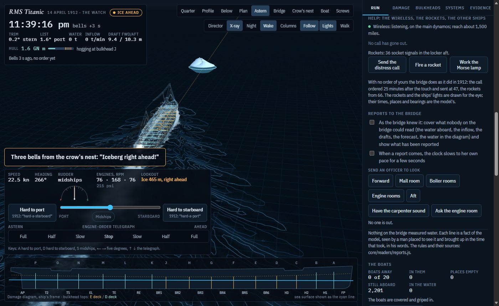
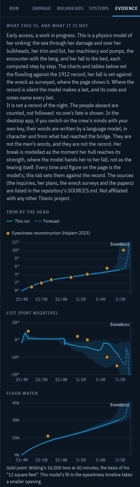

# Titanic Sinking Simulator

The sinking of RMS Titanic, computed, not animated. A flooding model of her 64 spaces, calibrated against the record
of 1912, runs under a page where you stand the watch of 14 April 1912. What you order decides what the ice does to
her; the model decides how she sinks, where she breaks and how her pieces fall to the bed.

**The physics and the people check each other.** Role play of the people of 1912 has no ground truth of its own, and
a sinking computed alone has nobody in it. Here the witnesses check the model: it is calibrated against what they saw,
and the Evidence tab sets the 1912 night beside them, row by row. The model checks the men: every order goes through
the watch's own log and the ship then does only what she can (no one turns her tighter than she turns), and a man
played by a language model knows only what has reached him. Today that is six men who answer the captain (Murdoch,
Moody, Boxhall, Hichens, Andrews and Bell), in the desktop app with a key of your own. Where a man can be as the water
rises is not built yet, and everyone else aboard is counted, not followed.

**Early access, a work in progress.** The core loop is playable: stand the watch, meet the ice, follow her to her
end, then go back and try another way. Expect rough edges, and expect things to change.

**Play now:** [https://bochen.xyz/titanic/](https://bochen.xyz/titanic/), in a desktop browser. It is made for a
large screen first; phones work, on a smaller stage.

**Download:** the app for Windows, from
[the latest release](https://github.com/bochen2029-pixel/titanic-sinking-simulator/releases/latest)
([how to run it](#the-app-for-windows)).



*The 1912 watch three seconds after the lookout's bells: the berg is ahead on her course line, and the wheel and the
telegraph are yours.*

## Your first minute

1. **Take the watch.** On the Run tab, under *Start here*, choose *Take the watch*, or open
   [https://bochen.xyz/titanic/#night=1912](https://bochen.xyz/titanic/#night=1912). You are on her bridge at
   11:39 pm, at 22½ knots on course 266°. Until she has passed the ice the clock runs at real time, so your reaction
   time is real. *Watch the 1912 orders*, beside it, plays the night as it was ordered instead.
2. **Wait for the bells.** Three bells ring from the crow's nest, and the Bridge gives the ice's range and bearing.
   A browser plays sound only after your first click or key.
3. **Give an order.** Put the wheel over with *Hard to port* or *Hard to starboard* (or the keys A and D), ring the
   telegraph (or the up and down arrow keys), or type the order in words under *Orders to the bridge*: "hard
   a-starboard and full astern". Helm orders are the 1912 tiller orders unless you switch them: "hard a-starboard"
   turns her head to port.
4. **Watch her answer.** She is slow: the rudder needs water moving past it. She clears the ice, is dented, has seams
   opened along her side, or runs her stem into it, and the Run tab says which.
5. **Run the night on.** Choose *60×* or *900×* on the Run tab. Reports reach the bridge, the boats are lowered, the
   wireless calls for help, and the line under the readouts forecasts her end.
6. **See how she ends.** On a watch she breaks where her own loads first reach what her hull can bear, and is handed
   to her fall there: her two pieces go down to the bed (choose *10×* before her end to watch them). A card says what
   happened, and *Copy a link to this watch* gives an address that replays it.
7. **Go back and try another way.** Drag the *Back to* bar under the speed buttons (or press the comma key) to any
   minute already played, and give another order there. *This night again* repeats the same berg; *Another night*
   draws a new one.

The User Guide, in [docs/guide/](docs/guide/) as PDF and HTML, takes each step further.

## The app for Windows

The same simulator as a portable app for Windows 10 or later, 64-bit, from
[the latest release](https://github.com/bochen2029-pixel/titanic-sinking-simulator/releases/latest):

1. Download `Titanic-win-x64-<version>-<commit>.zip` and unzip the whole folder (in Explorer: right-click the zip,
   then "Extract All..."). `Titanic.exe` cannot run from inside the zip.
2. Run `Titanic.exe` in the unzipped folder. There is no installer, and it needs no administrator rights. To remove
   it, delete the folder.

The app is not signed, so Windows SmartScreen may stop its first run with "Windows protected your PC". Choose "More
info", then "Run anyway", but only if you trust where the zip came from. The `.sha256` file published beside the zip
gives its SHA-256, and `certutil -hashfile <the zip> SHA256` prints the one of the zip you have, to compare.

What the app adds over the page: it keeps her settings in a `data` folder beside it, it needs no browser, and only
the app has the optional crew features below. The `README.txt` in its folder says more.

## The crew's minds and voices

### No key is needed

Everything in the simulator works with no key and no account. On a watch you are the captain: type an order as you
would say it ("hard a-starboard", "stop", "close the watertight doors") and the officer of the watch answers and
carries it out. Tick **Hear the bridge** and your own PC's voice speaks his lines aloud. Nothing is sent anywhere.

### Optional, in the desktop app only, with keys of your own

| What it adds | What you bring | Who is called, and with what | What it costs |
|---|---|---|---|
| **The crew's minds.** The men on the bridge answer your questions in words a language model writes for them, in character. Each such line is marked "imagined": they are never the men's recorded words | A key from Anthropic (Claude), OpenAI, Google (Gemini) or Cerebras. Or no key, with a model running on your own PC (LM Studio, Ollama) | That one provider, with your question and what the bridge has been told, when you ask the bridge something or a report reaches it | Your provider's price per answer. The app counts a run's questions and tokens and stops at your limits (200 questions and 300,000 tokens unless you change them) |
| **Deepgram's voices.** Each man speaks in a voice of his own | A Deepgram key | Deepgram, with the text of each line a man says | Deepgram's price per character (0.045 US dollars per 1,000 characters when read on 2026-11-23). A run sends at most 40,000 characters unless you raise it |

<!-- PUSH TO TALK: to show this row, delete the blank line above this comment and the comment's first and last
lines, so that the row follows the table's last row.
| **Speak to the bridge.** Hold Space and say your order | The same Deepgram key | Deepgram, with the sound of what you say, only while you hold the key | Deepgram's price per minute heard (0.0061 US dollars a minute when read on 2026-11-23). A run sends at most 30 minutes unless you raise it |
-->

- **Each is off every time the app starts.** Before one goes on, the app asks you in a message box of its own,
  naming who will be called and with what. F1 (About) says what is on.
- **A key is yours.** You type it into the app once. It is kept on your PC, encrypted by Windows for your user
  account, and sent only to the provider it belongs to. The app never shows it again, logs it nowhere, and "Forget"
  removes it.
- **The men know only what has reached the bridge:** a report, an order, their own eyes. Never the water you can see
  in X-ray, and nothing of how the night ends.
- **The web page has none of them:** a web page cannot keep a key safely.
- Nothing here has a subscription or an account of ours: you pay your own provider, if you choose to use one.

<!-- PUSH TO TALK: to show this point, delete the blank line above this comment and the comment's first and last
lines, so that the point joins the list above.
- **What you say** is sent only while you hold the key. Neither the sound nor the words are kept on your PC, and the
  app asks Deepgram to leave your voice out of its programme for improving its models.
-->

Deepgram's prices above were read on its price list on 2026-11-23, and prices change. No language model's price is
given here: they differ by provider and model. The crew's minds have not yet run on a real key, only against the
tests' stand-ins, so how long an answer takes and what a night costs are not yet known. With your own Deepgram key,
the desktop app can speak the officers' lines in seven of Deepgram's voices; the app's requests have been checked
against Deepgram's service with a real key (every voice answered), but hearing them played in the app on a real key
has not yet been tried.

## What is modelled, and what is not

The model works, a quarter of a second at a time:

- **Flooding** through 64 spaces (16 watertight compartments, each split port and starboard, above and below E deck),
  joined by 485 water paths on the 1912 damage: the holes in her shell, the watertight doors, the openings in her
  decks, the tops of her bulkheads, and her windows, her side's openings and the grand staircases' doors and domes,
  which hold until the sea breaks them in.
- **How she floats:** her rise and fall, her trim and her list, as one rigid body, from her drafts on the night.
- **How she handles:** her turning and her stopping, fitted to the trial record of the three sister ships.
- **The iceberg:** a body of ice she can miss, graze, dent or run her stem into. The contact makes the damage; no
  hole is painted on.
- **Her machinery:** coal, the fires in six boiler rooms, steam, two engines and a turbine, the steering engines, the
  dynamos and her lights, the watertight doors and the bilge pumps. Each fails when water reaches it, and what
  depends on it fails after it. The doors and the pumps take your orders.
- **The rest of the night,** followed without changing it: the reports that reach the bridge, late and in words; the
  twenty boats, uncovered, filled and lowered; the wireless, the rockets and the other ships.
- **Her strength along her length,** and the onset of the break: the first moment her own loads reach what her hull
  could bear, somewhere along her.
- **Her fall to the bed,** as a first model: her bow and her stern as two bodies of their own, carried 3,790 m down,
  with the wreck as surveyed laid beside them.

What it does not do, or does only roughly:

- **The break is a cut.** On a watch the flooding stops on the first step her loads reach her strength, and she is
  cut clean in two there for her fall. How her hull tore is not modelled. The engine has a joint between the two
  pieces that bends and tears before it lets go, but it is a what-if, and no default run uses it.
- **Where and when she breaks.** She breaks where her own loads first reach what her hull can bear: in the model
  that is at about 7 degrees of trim, over boiler room 2, at 2:16 am on the 1912 orders. The wreck parted over boiler
  room 1, about 5 metres farther aft; the published analyses put her angle then at 10 to 17 degrees or more; and
  nothing was tuned to close the gap.
- **The fall is a first model.** Each piece carries its air as one pocket; the air in her space by space is still to
  come. On the 1912 orders both pieces land upright, as the wreck's do, but the bow lands farther from the break than
  the wreck's bow lies. Handed over at the founder flag instead (a damage preset, or a watch's what-if), she goes
  down far by the head and on her beam ends, and on the 1912 damage her bow lands upside down. The pieces dive fast
  and then fall flat at a steady 8 to 9 m/s; the height of that first dive is the least certain part of the fall.
- **No trapped air while she floats,** except under a grand staircase's dome.
- **The decks above E deck are one space** in each compartment: water that comes in at a window is at once on the
  decks under it, where in the ship it had to find a stairwell first.
- **Speed reaches the holes only roughly.** The damage presets lie stopped, and only the 1912 damage among them is
  pumped.
- **A flooded ship under power is too fast.** Her resistance stays the intact hull's while her mass grows, so with
  water aboard and her engines turning she makes more way than she would have.
- **A crushed bow** changes neither her resistance nor her handling, and the page draws it open to the inside.
- **Her list** to port late in the night falls short of what witnesses saw, and her list to starboard just after the
  collision is smaller than the 5 degrees they saw.
- **Her stern's last minutes.** After the break the page's stern is under within 44 seconds, nearly level; it never
  stands on end, as the witnesses described it.
- **People are counted, not drawn.** The boats move places and minutes, and name nobody. They follow the model's rule
  for the night, not the record's minutes: it lowers boat No. 2 about 81 minutes after the collision, where the record
  has about 1:45 am, some 125 minutes after it.
- **Every outcome is an estimate.** Several inputs are informed guesses with a physical meaning (the strength of her
  plating, the berg's mass, the force at which a bow crushes, how her engineers worked the pumps, how readily people
  came forward to the boats), and the code labels each one a bet.

**The Carpathia question.** Could orders after the ice have kept her up until Carpathia came? A search over the orders
the model takes has found none that would. Its best night delays the break by about 5 minutes, and it is past no target on any
of the 79 versions of the model it was tried on, whether the target is the night as it went, the distress call made
at once, or the call made at once and five miles made toward Carpathia
([the result](docs/research/RESULT_carpathia_search_v5_2026-11-23.md)). That is this model's answer, not a verdict
on the night.

## Sources

Each number in the model is meant to name its source, or to say that it is a guess, in the research notes in
[docs/research/](docs/research/); one that does neither is a fault worth reporting. [`SOURCES.md`](SOURCES.md) lists the sources, as does the User Guide's Reference
chapter (chapter 11). The main kinds:

- the British and American inquiries of 1912: their testimony and their findings;
- Halpern's eyewitness reconstruction of her trim and list (2023);
- Hackett and Bedford's opening areas, compartment by compartment (RINA, 1996; tabled in JOM, 1998), which share the
  ice's damage out along her;
- the trial record of Olympic, Titanic and Britannic; *The Shipbuilder* of 1911, and *Engineering* of 1910 and 1914;
- the survey of the wreck, for where her pieces lie;
- her rooms: the deck plans drawn by Bruce Beveridge for *Titanic: The Ship Magnificent* (The History Press, 2008),
  as published by Encyclopedia Titanica, read on the page into tables of facts (which room, on which deck, in which
  compartment, where and how big). 28 of the 572 rows were checked against a 1912 original; the others rest on the
  plans alone. No drawing is reproduced;
- who was booked into the first-class staterooms: the Cave list of 1912, transcribed from the Nova Scotia Archives'
  scan of the original.

## Licence

MIT: see [LICENSE](LICENSE). The MIT licence covers the code. The tables under `data/` record facts, each credited to
its source ([SOURCES.md](SOURCES.md)), and whoever reuses them should carry those credits. What the simulator
includes from others, and under what terms, is in [THIRD_PARTY_NOTICES.md](THIRD_PARTY_NOTICES.md): three.js and the
fonts in the page, Electron and Anthropic's SDK in the app, and the terms under which the deck plans and the Cave list
are used.

## Faults and ideas

Open an issue at
[https://github.com/bochen2029-pixel/titanic-sinking-simulator/issues](https://github.com/bochen2029-pixel/titanic-sinking-simulator/issues).
What helps most:

- the watch's link: *Copy a link to this watch*, on the card at the end of a watch, gives an address that replays
  your night (in the app it copies the part after the `#`);
- what you ran it on: the browser and its version, or in the app the text of About (F1);
- what you saw, and what you expected.

## Not affiliated

This simulator is not affiliated with or endorsed by any other Titanic project, game or film, and it uses no other
project's drawings or assets. Its ship is drawn from the model's own numbers and from sourced tables of facts. Her
rooms' positions and names were read from the deck plans drawn by Bruce Beveridge for Titanic: The Ship Magnificent
(The History Press, 2008), as published by Encyclopedia Titanica. No drawing is reproduced, and any error in the
tables is ours.

---

## For developers: the model in detail

This part is for those who want to run the model, check it or change it. The User Guide is the full account: its
chapters 4 to 8 show the bridge, a watch and what follows the ice; chapter 10 ("How the model works, briefly") says what
the model computes, and chapter 9 ("The evidence") how it is checked against the record. Its tables and pictures are
made from the model's own outputs, and `node tools/guide_check.js` fails when the two drift apart.
[`CLAUDE.md`](CLAUDE.md) holds the conventions and the rules a working session starts from,
[`CHANGELOG.md`](CHANGELOG.md) what changed and when, and `docs/research/` the sources of its numbers and which of them
are guesses. The developer's record kept here until 23 November, with the figures of the model as it stood then, is now
[a dated record](docs/history/README_developer_record_2026-10-08_to_2026-11-23.md).

> The physics comes first. A headless core in plain JavaScript (`core/`) computes her flooding, her motion, her plant
> and her fall. The page and the app draw snapshots of its state, and give their orders through the watch's log. The
> core runs the 1912 night with no page at all, and a night replays bit for bit from its seed and its orders.

### Run it

- **The page:** [https://bochen.xyz/titanic/](https://bochen.xyz/titanic/), or build it yourself (below).
- **Headless,** with Node 18 or later and nothing to install:

| Command | What it does |
|---|---|
| `node tools/night_run.js 1912 auto sink` | the 1912 watch on its reconstructed orders, through the ice to her end |
| `node tools/titanic.js` | the 1912 damage preset as a table, against the eyewitness trim and list |
| `node tools/validate.js` | the validation cases (`out/validate.txt`) |
| `node tools/ledger_tests.js` | every row of the observation ledger, read against the 1912 damage preset (`out/ledger_1912.txt`) |
| `node tools/strength_tests.js` | her strength along her length, and the onset of the break (`out/strength_tests.txt`) |
| `node tools/fall_trials.js` | her fall to the bed: the free body's trials against closed forms and the wreck (`out/fall_trials.txt`) |
| `node tools/ensemble.js --jobs 2` | the kept set's members through the 1912 preset and the watch: their bands (`out/ensemble_1912.json`) |
| `node tools/record_night.js 1912 auto` | the watch step by step, as numbers for Blender or Unreal |

### Build it: the page, the guide and the app

- **The page.** `node tools/build_site.js` (`npm run build:site`) writes `dist/`, a static site with content-hashed
  assets, three.js and the fonts vendored, strict headers and an installable manifest; it works without
  `node_modules`. `node tools/build_site.js --check` says whether `dist/` is current, and `npm run serve` serves it at
  http://127.0.0.1:8080/. `wrangler.toml` publishes `dist/` as a Cloudflare static-assets Worker (`npm run deploy`).
  The public address is named in one place, `homepage` in `package.json`.
- **The User Guide.** Its chapters are Markdown in `docs/guide/src/`. `node tools/guide_shots.js` retakes its pictures
  from `dist/`, and `node tools/build_guide.js` writes its HTML and prints its PDF with headless Edge or Chrome.
  `docs/guide/README.md` says how to edit it.
- **The app.** `node tools/package_app.js` packages `release/Titanic-win-x64/` from the current `dist/` and the pinned
  Electron, which it copies (nothing is downloaded), and `node tools/app_test.js` is its self-test; its runtime
  packages come from `npm install --omit=dev --ignore-scripts`. CLAUDE.md says how its channels to the page are kept.

### How it is checked: the gate

`node tools/gate.js` (`npm run gate`) runs every suite and gives each one line. The headless suites run side by side
and the browser suites (headless Edge or Chrome) in turn, each within a deadline. A line says PASS, FAIL, or STALE when
a table the suite writes no longer matches the one tracked in `out/`. It takes about an hour on a laptop.
`--quick` runs the fast headless suites in about half a minute, `--only a,b` the ones named, and `--list` names them
all. Nothing goes to `main` before `GATE: PASS`.

- **Frozen references.** A change must not move these unless it means to, and says so in its commit:
  `out/seams_reference.json` (the core at rest, bit for bit), `out/headway_reference.json` (the ship under way),
  `out/golden_titanic.json` (the 1912 damage preset's trace) and the 1912 watch's fingerprint, held by
  `tools/systems_tests.js`. CLAUDE.md says when each may move.
- **One night, one result.** A watch is its seed and its orders, and it replays bit for bit on one engine. The model
  computes its own sine, cosine and ten other functions, and every power in `core/core.js`: fdlibm's routines in plain
  arithmetic, equal to Node's on every input tried (`tools/engine_tests.js`). So a watch leans on no engine's library
  for them, and the app's self-test holds the 1912 watch's fingerprint in the app to Node's.

### How it is calibrated, and what it is checked against

- **The history match.** Her uncertain inputs were calibrated together against an observation ledger of the 1912
  record: the ice's opening, the flows over and through her decks and bulkheads, the bunker's burst head and the
  others named in `tools/history_match.js`. A kept set of 30 members spans what the record allows
  (`out/kept_1912.json`), and its member C is the model's defaults. CLAUDE.md says how the match was run. A few
  constants are fitted in their own files, each named there: the berg's place on the 1912 night and the encounter's
  area constant (so that the contact makes the record's damage), the boats' and the reports' own fits, and the hull's
  weight curve.
- **The ledger** is `RECORD_1912` in `core/scenarios.js`. Each row is one thing one witness saw, with its source.
  `node tools/ledger_tests.js` reads every row against the 1912 damage preset: 12 of its 26 rows lie inside their
  bands at this commit (`out/ledger_1912.txt`).
- **The kept set's bands** (`out/ensemble_1912.json`), to the minute, since a change in a last bit moves the model's
  times by seconds:
  - On the 1912 damage preset she founders 152 to 178 minutes after the touch across the 30 members; member C at
    2:25:42 am.
  - On the 1912 watch her own loads first reach her strength 147 to 164 minutes after the touch; member C at 2:16:28
    am. There the watch ends and her fall begins.
  - From the times witnesses gave for other moments, the break the wreck shows came between about 2:15 and 2:20, and
    she was gone at 2:20. Some survivors saw her break; her second and third officers, Lightoller and Pitman, said
    she went down whole.
- **The Evidence tab** (the guide's chapter 9) plots a run's trim, list and water against Halpern's reconstruction,
  with the kept set's bands, and lists every ledger row with its witness, its source and the model's reading.



*The Evidence tab at 2:09 am on the 1912 damage: the run blue, the forecast dashed, Halpern's reconstruction gold.*

- **The validation cases** (`node tools/validate.js`; the figures are `out/validate.txt`'s at this commit). The fit
  keeps each verdict the record gives. The two cases whose sources disagree are reported and do not bind it:

| Case | Record | Model |
|---|---|---|
| Four forward compartments open | Wilding: she floats | afloat at 8 h, 2.04° by the head |
| Five forward compartments open | Wilding: she sinks | founders after 2 h 54 min |
| Olympic and HMS Hawke, 1911 | she reached port | afloat at 8 h, 0.74° by the stern |
| Britannic, 1916 (approximated, her ports open) | sank in about 55 min | founders after 59 min |
| Britannic, the same damage with her ports shut | designed to float with six compartments flooded | afloat at 8 h, 7.17° |
| Titanic's damage without boiler room 5's seam | Wilding: she still sinks, more slowly | founders after 3 h 14 min |
| Titanic, every bulkhead to D deck | Wilding: no help | founders after 3 h 04 min |
| Titanic, every bulkhead to B deck (reported) | divided, on nearby cases: the Court's report, afloat if No. 4 boiler room stayed dry; Wilding, lost once it flooded | afloat at 8 h, 7.61° (on a watch her loads reach her strength first) |
| Titanic, the watertight doors left open (reported) | debated | founders after 2 h 50 min |

### Known gaps

Each is in [`BACKLOG.md`](BACKLOG.md) or a design note, with its test.

- **Where and when she breaks, and how.** She breaks where her own loads first reach what her hull can bear: in the
  model that is at about 7 degrees of trim, over boiler room 2, at 2:16 am on the 1912 orders (x -10.93 m:
  `out/strength_tests.txt`). The wreck parted over boiler room 1, about 5 metres farther aft; the published analyses
  put her angle then at 10 to 17 degrees or more (`docs/research/RESEARCH_breakup_hull_girder_v1_2026-11-17.md`; no
  witness gave one); and nothing was tuned to close the gap. There the watch hands her to her fall, cut in two. How
  her hull tore is a what-if, a joint that bends and tears before it lets go (`K0.jointOnset`, off by default); with
  it all 30 kept members part at the surface, 1.25 to 4.69 s after the onset (`out/joint_kept_1912.json`).
- **Air trapped while she floats.** Only the air shut in under a grand staircase's dome is modelled. Air in every
  space is designed (NH7: `docs/DESIGN_NH7_air_in_every_space_v1_1_2026-11-24.md`, with its vents table
  `data/vents_1912.json`), not built.
- **The boats go early in places.** On the 1912 watch 11 of the 18 boats are lowered within ten minutes of Wormstedt,
  Fitch and Behe's times; the other seven go early, boat 4 by 47 minutes and boat 2 by 39
  (`node tools/people_tests.js`).
- **Her late list to port** falls short of what was seen. At 130 and 145 minutes after the touch, Halpern's
  reconstruction has 10 and 15 degrees to port, and the 1912 damage preset 2.0 and 7.8 (`out/ledger_1912.txt`). The
  cause is not found.
- **The stern's going down after the parting** is open (BACKLOG G34). Witnesses saw the stern settle back, rise
  until it stood on end, and stay afloat for twenty seconds (Etches) to about five minutes after she broke. On the
  page it is wholly under 44.3 s after the break (`out/night_after_tests.txt`), taken down by its one pocket of air
  and that pocket's stand-in vent. With her air taken space by space, the stern settles back toward level at once, as
  ten witnesses saw, but then floats, because nothing aft of the cut gives way.
- **The fall is not fitted:** the page shows what the model computes. Its one fitted number, each piece's lever, stays
  at zero in the engine, and trial 7 shows the fit beside it. On the 1912 watch both pieces land upright, the bow about
  1.6 km from the point under the break and the stern about 50 m (`out/fall_trials.txt`, trial 14), where the survey
  puts the wreck's bow about 0.8 km from it and its stern about 150 m.
- **Keys and the microphone, in part.** With a real Deepgram key, the app's requests were checked against Deepgram's
  service: every one of the seven voices answered, and its listening service heard orders spoken in one of its own
  voices, which the order line read as it reads typed ones. Not yet tried: the voices played in the app on a real key,
  a real microphone in the app, and the crew's minds on a real language-model key.

### The port, and the oracle

The C++/CUDA port, [sinksim](https://github.com/bochen2029-pixel/sinksim), reproduced the model as it stood in October
2026 bit for bit at every step of the 1912 run, and has not followed it since. [`PORTING.md`](PORTING.md) and
[`HANDOFF.md`](HANDOFF.md) describe that October core. Until a port matches the core again, the JavaScript core is the
oracle, and [`out/golden_titanic.json`](out/golden_titanic.json) is its frozen trace: the 1912 damage preset sampled
every 60 s, with her pose, her rates and the water in all 64 spaces.

### Layout

```
core/core.js          the flooding core: her columns, 64 spaces and their paths, the step, the rigid body
core/scenarios.js     the damage presets, the 1912 record (RECORD_1912) and the eyewitness data
core/motion.js        the ship under way: surge, sway, yaw, engines, telegraph, rudder (joined to the core by its seams)
core/encounter.js     the berg and the contact: dents, opened seams, the crushed bow
core/night.js         the seeded night and the watch: the lookout, the orders, the log that replays a night
core/systems.js       her plant: coal, fires, steam, engines, turbine, steering, dynamos, pumps, doors
core/readers/         readers of the night, none feeding back: the boats, the reports, the wireless and the other
                      ships, the hull girder, her strength and the break's onset, her fall, her rooms, her circuits
site/                 the page: app.js, its parts (site/parts/), the styles, the drawn ship (topsides.js, visuals.js)
app/                  the desktop app (Electron): its shell, the crew's minds and voices, the key store
data/                 sourced tables: her rooms from the deck plans (data/rooms/), her vents
tools/                headless runs, the suites and the gate, the builds, the calibration's tools
out/                  the tables the suites write and the gate holds, the golden trace, the frozen references
dist/                 the built page
docs/guide/           the User Guide: its chapters (src/), its pictures (img/), the built HTML and PDF
docs/research/        the research notes and experiments; docs/ also holds the design notes
web/, out/titanic.html  the October page (viewer version 1), kept as a record
BACKLOG.md            what is wanted and not built, each item with its test
