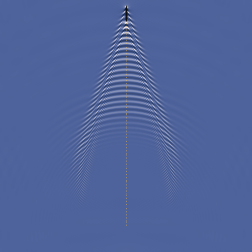
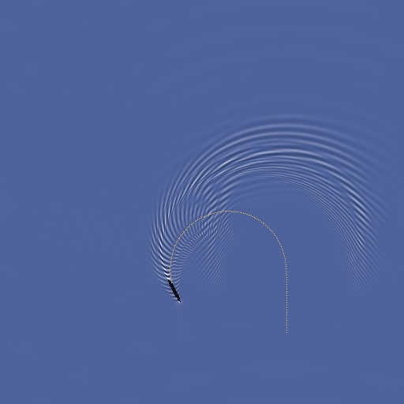
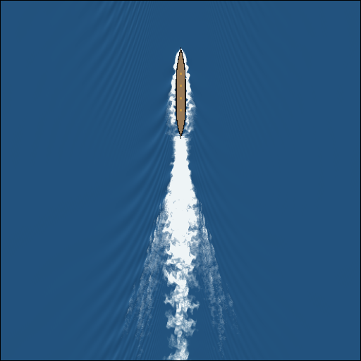

# Her wake, computed: waves from her own hull, white water from the waves (v2)

- **Written:** 2026-11-19, 14:09 to 14:42 CST, session 8b9ba51f (Claude Code desktop, Claude Fable 5.2; a fork of "Titanic simulator model accuracy"), at Bo's ask: "when james cameron made the movie titanic in 1997 he spent a lot of CGI to calculate realistic 'wake' of the ship, today we have cfd and other stuff C:\code\FluidX3D; search online and use whatever math you need and any tools etc C:\code\abacus and brainstorm for me how to make realistic 'wake' shapes for titanic dynamically based upon speed and turn or straight or etc... a parallel different session is doing this, try to improve upon it, and/or outdo it, and reference it and think harder". And, on this session's first picture: "your screenshot wake looks like the trail of a jet? most oceanliners and cruiseship wakes look more organic?"
- **Status:** advice only; nothing here is a decision. No model or page code was changed and nothing was committed. New files: this note; three experiments with their outputs and pictures (`docs/research/experiments/e50`, `e51`, `e52`, `results_2026-11-19/`); three research notes that this session's agents were still writing when this was finished (section 14).
- **Supersedes:** `BRAINSTORM_the_wake_computed_v1_2026-11-19.md` (14:05 CST, another session; left unchanged). v1's reading of the page's wake code, its certified numbers and its list of effects stand, and are not repeated here.
- **Baseline:** measured on the committed tree `a97a6bd`, exported, because `core/core.js` and `site/app.js` are being changed in this checkout today by another session. That session corrected her drawn stern this afternoon (the poop's round counter, above the water). What makes her stern's waves is the underwater hull, `C.halfBreadth`, which that work has not touched: `e50` run on the working tree at 14:40 CST gives the same figures to the last digit [M]. If the hull's ends are ever refitted, `e50` to `e52` are run again; each takes the tree as its argument.
- **Tags:** [M] measured this session (the experiment named); [A] certified by Abacus this session (receipt id); [R] read (file and line); [R7], [R8] in this session's research notes, which carry their own tags for each source; [D] derived; [B] bet.

## 0. Changes in v2

1. **Her spectrum is computed, not planned.** v1 proposed Michell's theory with its formulas "from memory". Here it is run on her own hull, and the code is checked two ways: it gives the published Michell figures for Wigley's hull to four digits, and a time-domain solution of the same physics that contains no Michell formula leaves on the sea exactly the energy the integral says (100.0 %) (section 3).
2. **Thin-ship theory overshoots her wave drag about threefold,** not v1's "factor of 1.5": 1,103 kN at 22.5 kn against the 361 kN that the motion model's resistance spends on waves. So the heights are scaled to the model's own energy, and the model's hull turns out to have a blunter waterline than v1 guessed (15 to 16 degrees of entrance, not 12) (section 3).
3. **The dynamic wake is prototyped.** A wave field driven by her hull along the motion model's real track makes a Kelvin wake that nothing told it to make (wavelength 85.77 m against the theory's 85.81; the wedge closing on 19.47 degrees), bends it round a hard-over turn, and lets her waves catch her when she stops (section 4). v1 listed this method as its third choice, "a good cross-check". It is my first.
4. **v1 has the turn's bow wave on the wrong side at the stem.** By the motion model her stem moves inward in a turn: the water meets it 6 degrees on the inside bow and meets her stern 18 degrees on the outside. Her sideways motion adds two thirds to the wave energy of a turn and makes the wake two and a half times as high outside the turn as inside (section 4).
5. **The white water is the wake.** Bo's remark is right: v1 and my first picture were both about the waves, and what the eye calls a liner's wake is mostly foam. Section 5 gives it three laws and a prototype, and the white water is moved to the front of the build order.
6. **What the film did is read, not recalled** [R7, from Cinefex 72]: its sea was computed and its wake was photographed off a real ship (section 2).
7. **iWave is ruled out with numbers, and the published wave packets have no boat emitter** [R7] (section 8).
8. **FluidX3D's speed on this machine is measured,** from Bo's own runs of 15 November: at least 697 million cell-steps a second [M, A]. That makes a coarse tank run ten minutes, not hours (section 7).

## The answer in one paragraph

A liner's wake is two things laid on each other: a pattern of waves, which is physics that can now be computed exactly and live, and white water, which is what the eye sees and what the film had to photograph. Compute the waves as a field: the sea's surface on a grid that follows her, every wave turning at its own true frequency, pushed by her hull as three fixed footprints scaled by her surge, her sway and her yaw rate from the motion model. That one law gives the Kelvin wedge, the bow and stern systems and their interference, the lopsided wake of a turn, the waves that overtake her when she stops and the wake of sternway, with no table and no special case, and its heights are tied to the motion model by energy: the wake carries off exactly the 4.2 MW her resistance spends on waves at 22.5 knots. Then let the waves make the white water: foam is born where the computed surface is too steep to stand and where the screws' race comes up, it is left on the water where it was made, it is stirred by eddies, and it dies. That is the organic part, and it is cheap. FluidX3D is the towing tank that sets the few numbers linear theory cannot (the bow wave's pile-up, where it breaks, how the hull carries foam aft); it never runs in the page.

## 1. Why the first picture looked like a jet's trail

That picture [M: e51] is true and is not what anyone sees. It is the height of the sea in false colour from 4 km up, 22.5 knots, a 4 km square. It shows one thing of five:

| What a wake is made of | Its law | Driven by (all in the model already) | What the eye gets from it |
|---|---|---|---|
| 1. The waves (Kelvin's pattern) | linear waves on deep water, forced by the hull | surge, sway, yaw rate, her place and heading | by day, glitter and long slow swells; by night, the stars' reflections moving. Never white |
| 2. The bow wave | the same, piled up by effects linear theory lacks | speed, draught, the bow's angle | the "bone in her teeth": the one white thing ahead of amidships |
| 3. Breaking | a surface steeper than it can stand turns to foam | the slopes of 1 and 2 | white sheets off the bow and feathers off her sides |
| 4. The screws' race and the hull's turbulent wake | a jet, then a spreading turbulent wake full of air | thrust and shaft speed of three screws, the rudder | the long white road astern, with billowing edges |
| 5. The slick | water left smooth where the turbulence was | 4, later | a calm scar, for many minutes |

Two things make a drawn wake look synthetic, and both are in that picture: the waves are perfectly coherent (a real sea is never still enough, and steep crests break before they get that sharp), and there is no white water at all. Section 5 is about putting it back.

## 2. What the film did

[R7, read in the text of Cinefex 72, December 1997.]

- Digital Domain used **computed water for nearly every shot of the ship at sea**: Arete's ocean package, the one that had made Waterworld's sea. It had no interaction between objects and water. About four months went on fitting it.
- **The wake was photographed.** Texture maps of the wakes and white water coming off the bow and sides were shot from a crane aboard the Lane Victory, a restored wartime merchant ship, off California, and laid on the computed sea. One wide day shot kept the Lane Victory's own wake and water and put the digital Titanic over her.
- Her third screw's wake was made by doubling the Lane Victory's twin-screw wake and blending in a third.
- The bow wave's shape came from a procedure in Arete's package that depended on hull and speed; how it worked is not said.
- **The calm night sea was a hand-written shader,** tuned shot by shot, because the ocean package did badly at low wind.
- 40 minutes a frame looking straight down; three and a half to four hours with the horizon in frame.

So in 1997 the waves were computed and the organic part was taken from a real ship, because it could not be computed. Nothing in the film answered a helm: every shot was a fixed course, rendered offline. What is asked for here is the opposite on both counts.

## 3. Her waves from her own hull

### 3.1 The formulas, pinned

Convention: x forward from amidships, zeta up from the waterline, she moves toward +x at U through still water, Y(x, zeta) her half-breadth, `k0 = g / U^2`, theta a wave's direction of travel from her course. A wave that keeps station with her has wavenumber `k0 sec^2(theta)`.

- Her free-wave spectrum: `A(theta) = -(2 k0 / pi) sec^3(theta) x the integral over her centre plane of dY/dx exp(k0 sec^2(theta) zeta + i k0 sec(theta) x)`.
- Far astern: `height = Re of the integral over theta of A(theta) exp(-i k0 sec^2(theta) (x cos(theta) + y sin(theta)))`.
- Michell's integral: `Rw = (4 rho g^2 / (pi U^2)) x the integral from 0 to 90 degrees of |that hull integral|^2 sec^3(theta)`.
- Havelock's form of the same: `Rw = (pi / 2) rho U^2 x the integral of |A|^2 cos^3(theta)`.

The constants are no longer from memory. [R8 1.2 to 1.5] read Michell's integral in Boucher and others (arXiv 1803.10695) and the spectrum in Buttle and others (arXiv 2205.01870), and showed the two agree through Havelock's formula only with these constants. And `e50` [M] gives, for Wigley's parabolic hull, 1.064, 0.975, 1.831 and 4.154 (Cw x 1000 at Froude 0.25, 0.267, 0.316 and 0.45) against Peri's published 1.064, 0.976, 1.831 and 4.154 [R8 2.1].

### 3.2 Her numbers

`e50` on `C.halfBreadth` at the night's draught (9.83 m): the grid holds her displacement to 14 t (49,035 against 49,021); block 0.669, prismatic 0.688, waterplane 0.776 [M].

| kn | Waves along her | Rw, Michell (kN) | Rw, Holtrop (kN) | Michell over Holtrop | Holtrop's waves, of her whole resistance | Power into waves (MW, Holtrop) | Height astern, scaled (m, crest to trough, 300 m back) |
|---|---|---|---|---|---|---|---|
| 10 | 15.3 | 25 | 0.4 | 60 | 0.1 % | 0.002 | 0.04 |
| 14 | 7.8 | 179 | 13 | 14 | 2 % | 0.09 | 0.2 |
| 18 | 4.7 | 485 | 90 | 5.4 | 9 % | 0.83 | 0.4 |
| 20 | 3.8 | 903 | 180 | 5.0 | 13 % | 1.9 | 0.8 |
| 21 | 3.5 | 690 | 244 | 2.8 | 16 % | 2.6 | 0.04 |
| 22.5 | 3.0 | 1,103 | 361 | 3.1 | 19 % | 4.18 [A: abacus1:9d86b3d83e5b] | 1.2 |
| 24 | 2.7 | 1,246 | 510 | 2.4 | 23 % | 6.3 | 0.7 |

"Holtrop" is the wave-making part of the method whose shape the motion model's resistance takes (`SHIP.resist`; `e16`). The last column is Michell's transverse wave scaled by the square root of the two resistances [D].

What it says:

- **Thin-ship theory is three times too generous to her at full speed and sixty times at 10 knots.** That is its known fault at these speeds: for Wigley's own hull it is 1.4 to 2.9 times the tank between Froude 0.21 and 0.29 [R8 2.1]. And her modelled hull is blunt where it matters: the waterline of `C.halfBreadth` enters at 15 to 16 degrees and leaves at 17 to 19 [M], where Holtrop's regression gives 11 for a ship of her coefficients. The hull was fitted to her hydrostatics, not to her ends. A wake built on raw thin-ship heights would be 1.7 times too high.
- **So scale it by energy.** Multiply the heights by `sqrt(Rw Holtrop / Rw Michell)` at her speed: 0.572 at 22.5 kn [A: abacus1:07c78dfa69b5]. Then the wake carries off exactly what the motion model spends on waves, at every speed, and the viewer and the model cannot disagree. It reads the model and feeds nothing back.
- **Below about 14 knots there are no waves to draw.** Her wave power falls from 4.2 MW at 22.5 kn to 90 kW at 14 and 2 kW at 10. At low speed her wake is white water and nothing else.
- **Her bow and stern systems interfere, hard.** The wave straight astern nearly vanishes at 21 kn (0.07 m of |A| against 1.9 m at 22.5): by Michell her bow's and stern's transverse waves cancel there. `Rw / U^6` has hollows near 21.5 kn and humps near 20 and 23 [M]. The simple rule puts the sixth hollow at 22.52 kn for a wave-making length equal to her waterline [A: abacus1:e432e6b5b757]; her own curve moves it a knot down. A real hull's hollows are shallower than thin-ship theory's, but the effect is real: her wake at 21 knots is not her wake at 22.5 turned down.
- **Near her, the steep divergent waves are the highest, not the cusps.** At 22.5 kn the transverse waves carry 53 % of her wave resistance and the divergent 47 %; within 1.4 km the highest waves stand 10 to 15 degrees off her track, inside the wedge [M: e51]. v1's "the cusps are what a far observer sees" is a statement about far away.
- **Waves by length:** those longer than 60 m carry 51 % of her wave resistance, longer than 30 m 86 %, longer than 20 m 93 %, longer than 10 m 98 % [M: e51]. That is the table that sizes a grid.
- At her load draught (10.54 m) the same speed makes 16 % more wave resistance [M]: down by the head after the ice she is another hull.

## 4. The dynamic law: one field, three footprints

### 4.1 The law

The sea is still and deep (that night it was both), so linear theory is the right theory. For each Fourier mode of the surface:

`dh/dt = |k| phi + w0`, `dphi/dt = -g h`

with h the height and phi the potential at the surface. Each mode turns at its own exact frequency, `omega^2 = g |k|`, so there is no dispersion error for any wave the grid holds, at any time step. This is Tessendorf's eWave step [R7 1.3], and it is the whole of the wave physics.

`w0` is what her hull does to the surface, and it is three fixed pictures in her own frame, computed once from her hull:

- **surge:** Michell's sources on her centre plane, `-2 u dY/dx`, each felt at the surface through `exp(-|k| depth)`. Out where the bow widens, in where the stern closes.
- **sway and yaw:** the water meets station x across her at `v + r x`. Each section then pushes water aside as a dipole, of moment its own area plus its sway added area a metre of length [B: 0.9 of a half circle on her draught].

At each step the forcing is `u S_u + v S_v + r S_r`, turned to her heading and moved to her place. `site/visuals.js:218` already lays down exactly these numbers every half second.

### 4.2 What the prototype shows

`e51` [M]: a 4 km square of 8 m cells, her track from `core/motion.js` (`stepAlone`), nothing in the code about wakes, wedges or wavelengths.

**Straight, 22.5 kn, 300 s.**

| Measured on the field | Field | Theory |
|---|---|---|
| wave resistance, from the energy left on the sea | 1,027.7 kN | 1,028.2 kN (Michell, the same waves): 100.0 % |
| transverse wavelength on her track | 85.77 m | 85.81 m |
| transverse wave's height 300, 600, 1,000 m astern | 2.28, 1.47, 1.12 m | 1.73, 1.32, 1.06 m (stationary phase: the far-field law, met as distance grows) |
| the wedge's edge 600, 1,000, 1,400 m astern | 21.4, 20.9, 20.2 degrees | 19.47, approached from outside |
| port against starboard | 128 m and 128 m | mirror |

(Heights here are thin-ship's own, unscaled.)

**Hard-a-starboard at 40 s, held to 300 s** (her head to port).

| From the motion model, steady in the turn | Value |
|---|---|
| speed | 22.5 kn falls to 15.6 |
| rate of turn | 0.78 degrees a second |
| drift amidships | 6.3 degrees |
| the water meets her stem | 6.2 degrees on the **inside** bow |
| the water meets her stern | 18.3 degrees on the outside |
| the point with no sideways motion | 65 m forward of amidships (64 m abaft the stem) |

| On the field | Value |
|---|---|
| wave energy on the sea at 300 s | 2.20 GJ; with her sideways motion left out of the forcing, the same track: 1.32 GJ |
| height 60 to 260 m either side of her track | 0.34 m rms outside the turn, 0.13 m inside |

So a turning hull is not a straight hull on a curved path, as v1 said, and the size of it is now known: two thirds more wave energy, and a wake two and a half times as high outside as in. But v1's picture of it needs one correction. Her pivot is a quarter of her length from the stem; ahead of it she swings inward. The inside bow takes the water at the stem, and everything from 64 m abaft the stem to the taffrail sweeps outward at up to 18 degrees. The big wave of a turn is thrown by her after body, to the outside.

[R8 4] confirms the shape from the literature: on a circular course "the wake is compressed within the circle and stretched outside it" (Pethiyagoda and others 2021), and only a straight course or a steady circle gives a pattern that rides with the ship (Stoker 1957). Nobody there gives heights for a hull with drift; these are new.

**Both engines full astern at 60 s.** She loses her way 195 s later and 1,097 m on [M: the motion model]. Her own waves come up with her as she stops and run past for a minute: the sea at her stern and at her stem moves by 0.3 to 0.4 m (thin-ship heights; about 0.2 m scaled) [M]. [R8 4] has the rule: the transverse waves made at speed U travel at U and their energy at U/2, so the train made d metres astern reaches her d/U seconds after a sudden stop; and "after she stops the wake is mostly transverse". Held astern she gathers sternway and makes a wake from her stern, with no new code.

### 4.3 What the field does not do

- **It cannot break.** Linear waves do not steepen into foam. Section 5.
- **It cannot pile up the bow wave.** It gives 0.5 to 1 m at her stem, scaled [M: e52], where the bow-wave relation of Noblesse and others (2008) gives 3.0 m for a half-angle of 12 degrees and 4.4 m for the model hull's 16.6 at 22.5 kn [R8 5: the height formula is v1's recollection, not read, but it agrees exactly with a boundary that was read]. The bow wave is put in by rule (5.1) until the tank measures it.
- **It ends at its window.** Beyond it the page's present construction carries the pattern on, now with real heights (section 6).
- **Its short steep waves are thin-ship's worst.** Her spectrum does not die away toward 90 degrees: |A| is still 2.6 m at 80 degrees, where the wave is 2.6 m long. Those are the waves that break. They are converted to foam, not drawn (5.1).

## 5. The white water: three laws

`e52` [M]: the same wave law on a fine grid that moves with her (1 km square, 2 m cells, waves down to 4.7 m), heights scaled by 0.572, 22.5 kn, from above under a low sun [appearance: on the night there was none].

### 5.1 It is made in three places

1. **Where the surface is steeper than it can stand.** Foam at a rate proportional to the excess of the local slope over a limit [B: 0.10 for this scaled linear field; the true limit of a real crest is nearer 0.3 to 0.4, and the tank sets the bet]. On the computed field this picks out the bow wave's shoulders and the first divergent crests along her sides: 15,800 m2 of sea steeper than the limit at 22.5 kn [M]. Because her wave heights fall so fast with speed (3.2), so does this, with no rule about speed.
2. **At the bow, by rule.** Since the field cannot pile the bow wave up, a sheet is thrown off each bow from 5 to 40 m abaft the stem [B]. Whether a bow wave breaks is known: it is a steady overturning breaker when `U / sqrt(g x draught)` exceeds `4.4 tan(a) / cos(a) - 1`, a the waterline's half-angle (Delhommeau and others 2009) [R8 5, read]. For her that is every speed above about 7 knots. So the bone in her teeth is physics at any speed she steams at, and its strength should follow the relation's height: 4.4 m at 22.5 kn, 3.1 at 18, 1.2 at 10 for the model hull's angle [R8 5].
3. **In the screws' race.** Three races come up astern. Foam at a rate proportional to thrust [B], so a ship coasting with stopped engines leaves waves and almost no white road, and one going astern throws it forward along her sides (the page's `washFx` already does that part).

### 5.2 It is left where it was made

Foam does not travel with a wave. It stays on the water, so past her it streams astern at her speed. Three consequences, each visible in the picture:

- the bow's foam runs **along her sides** as the white band at the waterline, because the water is pushed aside round her hull and closes in again astern [B: in the prototype the foam keeps its distance off her plating; the tank gives the real flow];
- the breaking crests leave **feathers** that lie where each crest was, fanning out behind her;
- in a turn the white road is laid on the stern's track, which runs outside her middle's, and her after body sweeps a wide smooth patch inside it.

### 5.3 It is stirred, and it dies

- **Eddies.** The wake's edges billow because the wake is turbulent. In the prototype the foam is carried by a field of eddies 14 to 74 m across, stronger where the water is whiter, their places drawn from a seed [appearance: the places; their size is the wake's width]. This single thing is most of "organic".
- **Spreading.** The white road widens as the fifth root of distance for a ship under power [R: `site/visuals.js:209`], because a self-propelled hull leaves no net momentum behind. A coasting hull drags its wake and it spreads as the cube root; a ship backing or starting makes a jet, which spreads fastest [B: the textbook wakes; R9 was to confirm]. The page lays down thrust with every sample, so it can tell which.
- **Dying.** A breaker's foam lasts seconds to tens of seconds [B: 14 s here]; the aerated road lasts a minute or more [R: the page's 75 s]; the slick lasts ten minutes.

In the prototype at 100 s: 25,900 m2 white from breaking, 20,100 m2 from the race; the white road 46 m wide 20 m astern of her and 170 to 250 m wide with its feathers at 400 to 600 m [M]. All of the strengths are bets; none of the places is.

### 5.4 What it buys that painting cannot

The white water follows the helm and the telegraph because its sources do. Ring down from Full and the feathers go first (the waves die as speed to the sixth), then the bow's bone, while the road thins with thrust. Put the helm over and the outside of the wake whitens. Go astern and the white is ahead of the screws. None of that is a special case.

## 6. The page

**Layers**, each a texture on the sea round her, each [appearance] with a stated law:

| Layer | Holds | Size and cost [M: e51, one thread of Node] |
|---|---|---|
| far field of waves | waves 30 m and longer (86 % of her wave energy) | 256 x 256 of 12 m: a 3 km square; about 1 ms a step and 1.9 ms a transform |
| near field of waves | waves 5 to 30 m: the ones that break | 256 x 256 of 2 to 3 m: 500 to 770 m square, moving with her; the same |
| white water | two foams (breaking, race) and the slick | the near field's grid, plus a coarser one astern |
| beyond the far field | the pattern out to the horizon | the page's present lines (`kelvinCrest`), with heights from her spectrum |

At 512 x 512 a step of the field costs 3.9 ms and a transform 11.3 ms [M]. At 256 x 256, twenty times a second in a worker, both wave layers are a few milliseconds. Waves of 57 m have a 6 s period; they do not need sixty updates a second. A WebGL version of the same step exists in the wild [R7 1.3] if a phone needs it.

**Seams with what is there:**
- `VS.wakeTake` (`site/visuals.js:218`) already records t, X, Y, psi, u, v, r and thrust every half second. That record is the whole input. Nothing new is read from the model.
- The white ribbon (`site/app.js:792-822`) is replaced by the white-water layer. `tauWaves: 150` goes: waves spread, they do not fade (v1 said so).
- The sea's two shaders (`site/app.js:204`; the Night look's in `site/parts/20_night_scene.js`) take the height texture for their slopes.
- The hull's waterline can be read from the near field: the crest at the stem, the trough abaft it, the three waves along her at full speed.

**The three looks:**
- *Night* (the look that matters): no sun. The waves are seen only as the stars' reflections moving and as her own lights' broken paths; the foam is a faint grey by starlight and bright in the light from her ports. Whether a lookout could see the foam at all is a number, not a taste [R9 was to give it].
- *X-ray:* the height as contour lines in place of today's drawn crests, the foam as its outline. The look keeps its language.
- *Day:* Bo's reference pictures are daylight. The page has no day look; e52's picture is what one would start from (decision DK6).

**Only this simulator has:** the iceberg (a mask on the field gives its reflection, its shadow and the only breaking water at its foot); the stop after the ice, with her own wake running past her; sternway; a hull down by the head (her footprints recomputed for the trimmed waterline: 16 % more wave-making at the load draught alone); and boats that the field could rock [appearance].

## 7. FluidX3D: the towing tank, costed from this machine

- **It runs here, and fast.** `C:\code\FluidX3D\bin\FluidX3D.exe` was built on 15 November for the jet-art wind tunnel. Its `summary.txt` gives a grid of 304 x 609 x 203 and its `forces.csv` 4,747 steps; the third run finished 256 s after the second [M: file times]. That is at least **697 million cell-steps a second** [A: abacus1:ef9efbebb03d], with the subgrid model and force field on and no free surface. FluidX3D's own chart gives 1,282 for this chip, the Arc 140V [R: `README.md:991`].
- **Memory:** 55 bytes a cell, plus 12 for the free surface [R: `README.md`; `src/defines.hpp:22`].
- **A free surface with gravity and a moving inflow is in the box:** the shipped "hydraulic jump" and "river" setups use them together [R: `src/setup.cpp:954`, `:1109`]. A hull held still in a stream with a free surface is that setup with her STL in it.

| Run | Cells | Her beam, her draught, a cusp wave in cells | Steps for three passes of the box | Time here [D, at 400 to 700 million a second with the surface on, B] |
|---|---|---|---|---|
| coarse: 1.3 m, box 512 x 192 x 192 | 19 million (1.3 GB) | 22, 8, 44 | about 20,000 | **9 to 16 minutes** |
| fine: 0.65 m, box 1024 x 384 x 384 | 151 million (10 GB) | 43, 15, 88 | about 41,000 | 2.5 to 4.5 hours |

v1 planned thirty to sixty runs at the fine size: days. Do it in two tiers: the whole matrix coarse in an afternoon (speeds 14, 18, 20, 21, 22.5, 24 kn; drift 0, 6, 12 degrees; level and down by the head), then three or four fine runs where the bow wave matters.

**What to ask of it** (the things linear theory cannot say):
1. the bow wave's height and where it breaks, against speed: this sets the bow rule and the slope limit of 5.1;
2. her real spectrum by a wave cut alongside (v1's idea): how much weaker the stern's system is than thin-ship theory makes it, and where the hollow near 21 knots truly is;
3. the flow that carries foam along her sides and into the wake;
4. the outside and inside of a drifting hull.

**Limits:** the Reynolds number is a model's, so the stern's boundary layer is too thick, as in any tank. The licence allows personal, research and education use and no commercial use, and an altered source must be published if results are [R: `LICENSE.md`; v1 read it]: its code and setups stay out of this MIT repository, and its outputs are numbers for a personal project.

## 8. The run-time methods, compared

| Method | True dispersion | Kelvin's wedge untold | Bow and stern interference | A turn, a stop, sternway | Near her, where foam is born | Verdict |
|---|---|---|---|---|---|---|
| Today's lines (`kelvinCrest`) | yes | no: it is the construction | no: one source at the bow | geometry yes, heights no | no | keep, as the far field, with heights |
| iWave (a 13 x 13 kernel) | **no**: its kernel is 43 times too stiff for long waves and 4 times too soft for short; group over phase speed runs 0.09 to 0.36 where deep water has 0.5 [R7 1.2, derived there] | no: about 12 degrees, by accident of the grid | - | - | - | out |
| Wave packets (Jeschke and Wojtan 2017) | yes | yes, if emitted rightly | only if the emitter carries phase | yes | poor: thousands of short packets | v1's pick. The released code has **no boat emitter** and the paper's rule could not be read [R7 1.5]: the emitter would be ours to invent |
| Water surface wavelets (2018) | yes | yes | **no**: amplitude without phase across directions [R7 1.6] | yes | no | out for her: the interference is her wake's character |
| **The field (eWave's step, her footprints)** | exact | yes [M] | yes [M] | yes [M] | yes, on a fine window | **my pick**, with the lines beyond it |
| CFD in the page | - | - | - | - | - | no |

Why not packets, in one line: they are a clever way to avoid a grid, and her wake needs a grid anyway, for the foam.

## 9. Tests (causes, not looks)

| | Cause set | Outcome | Band, and what the prototype gave |
|---|---|---|---|
| 1 | Wigley's hull through the spectrum's code | Cw at Froude 0.25, 0.316, 0.45 | Peri's 1.064, 1.831, 4.154 to 0.1 % [got: 1.064, 1.831, 4.154] |
| 2 | straight at 22.5 kn, the field unscaled | energy left on the sea per second, over U | Michell's Rw for the same waves within 1 % [got: 100.0 %] |
| 3 | the same | transverse wavelength on her track | `2 pi U^2 / g` within 0.5 % [got: 0.05 %] |
| 4 | the same | the wedge's edge at 600, 1,000, 1,400 m | falling toward 19.47 degrees, never below [got: 21.4, 20.9, 20.2] |
| 5 | the same, scaled | energy per second | the motion model's wave power (4.18 MW at 22.5 kn) within 2 % |
| 6 | a straight run and its mirror | the fields | mirror images to rounding |
| 7 | hard over | height outside over inside the turn | over 1.5 [got: 2.5]; with sway and yaw left out, 1 within 20 % |
| 8 | a window half the size | the field inside it | within 2 % of the larger window's: nothing comes back off an edge |
| 9 | Stop from Full | white water from the race | falls with thrust; the feathers gone below 14 kn |
| 10 | the part on and off | the watch's fingerprint | the same (`3810e155` for 1912) |
| 11 | the tank, at a speed and a drift not used to set anything | bow wave height, wave cut | reported against the page's |

## 10. Build order

| Id | Step | Size | Done when |
|---|---|---|---|
| K0 | The three research notes finished | S | written; the bets of sections 5 and 7 that they settle, settled |
| K1 | Her spectrum as a tool: `tools/wake_spectrum.js` writes |A| by direction and speed, Rw, and the energy scale | S | tests 1 and 5's arithmetic |
| K2 | **The field:** a module the page and Node both run; two windows; her three footprints at load; fed by `wakeTake`'s record | M | tests 2 to 8, headless |
| K3 | **The white water** on it: the three sources, left on the earth, the eddies, the dying; the ribbon retired | M | test 9; pictures looked at beside photographs of liners |
| K4 | The looks: Night (reflections, foam by her own lights), X-ray (contours) | M | the browser suites; test 10 |
| K5 | Heights on today's lines beyond the window | S | the lines and the field agree at the seam within 10 % |
| K6 | The tank: her hull as an STL, the coarse matrix, three fine runs | S of attention, an afternoon and a night of machine | section 7's four answers, and test 11 |
| K7 | The berg, the stop, sternway, the trimmed hull | S each | each a picture and a number |

K2 and K3 are the wake. K3 is what answers Bo's remark, and it needs K2's slopes, so they go together and first.

## 11. Decisions needed (who decides)

| | Decision | Pick | Who |
|---|---|---|---|
| DK1 | The run-time method | **The field in two windows, the present lines beyond.** v1 picked wave packets | Bo |
| DK2 | The heights | **Scaled to the motion model's wave energy.** Or thin-ship's own, 1.7 times higher at full speed | Bo |
| DK3 | What is built first | **K1, then K2 and K3 together.** v1 had heights on the lines first, which leaves the wake without white water | Bo |
| DK4 | The eddies | **From the night's seed, marked appearance.** Without them the wake's edges are ruled lines | Bo |
| DK5 | The tank | **Start the coarse matrix once K1 exports her hull;** its setup file kept outside this repository | Bo |
| DK6 | A day look | **Not yet:** night and X-ray first. Bo's reference pictures are daylight, so this is his | Bo |
| DK7 | Her hull's ends | **Leave `C.halfBreadth` alone** (it is the flooding model's hull) and let the energy scale absorb its bluntness. Or refit the waterline's ends to a lines plan, for the wake only: her entrance (15 to 17 degrees here) and her run under the counter (17 to 19 degrees), the under-water part of the stern Bo has just had corrected above water | Bo |

## 12. Risks

- **Every strength in the white water is a bet** (the slope limit, the three rates, the two lifetimes). The places are physics; the amounts are set by eye and by the tank. A wake tuned by eye alone will look right at 22.5 knots and wrong at 15.
- **Scaling by energy fixes the total, not the shape.** Thin-ship theory also puts too much into steep divergent waves and makes the hollow at 21 knots too deep. Only the tank's wave cut corrects the shape.
- **The sway and yaw footprints rest on one bet** (the dipole's strength), and a hull drifting at 18 degrees sheds a wake that no potential flow has. The turn's figures are of the right kind, not the right size.
- **Two windows have a seam,** in space and in wavelength. Test 8 and K5's check are there for it.
- **A phone.** A few milliseconds twenty times a second in a worker is a bet until measured on one.
- **Night.** The most important look is the one where the waves are nearly invisible and the foam is grey. It may be that most of this is seen only in the X-ray look. That is honest, and it should be said on the page.
- **Three research notes were unfinished** when this was written (section 14).

## 13. Not known

- The bow-wave relation's height formula from the paper itself (the breaking boundary is read; the height, its place abaft the stem and its profile are not: the papers are PDFs the tools could not open).
- Her true waterline entrance. The model's hull gives 15 to 17 degrees, Holtrop's regression 11, v1 guessed 12; no lines plan or study was found [R8 6].
- How strong the stern's wave system really is against the bow's.
- The white wake's measured constants and lifetimes; a big ship's drift and pivot in a turn from a source other than our own model; whether her foam could be seen by starlight: all R9's, unwritten.
- How FluidX3D's free surface runs on this chip. The speed quoted is without it.

## 14. Sources, and what was not checked

Read in this repository at `a97a6bd`: `site/visuals.js:200-301`, `site/app.js:200-236` and its wake's lines, `core/motion.js:1-190` and its exports, `tools/motion_trials.js:1-60`, `docs/research/experiments/e16_resistance_shape.js` (Holtrop's method, copied into `e50`), v1 of this note and its Abacus requests.

Read in `C:\code\FluidX3D`: `README.md` (the benchmark chart, the memory figures), `DOCUMENTATION.md` (the surface extension), `src/defines.hpp` and `src/setup.cpp` as altered on 15 November, `bin/export/sp1_a12/summary.txt` and `forces.csv`.

Measured (scripts in `docs/research/experiments/`, outputs and pictures in `results_2026-11-19/`): `e50_michell_her_hull`, `e51_wake_field_prototype`, `e52_wake_white_water_prototype`. Each takes the tree to run on as its argument.

Certified by Abacus this session: `abacus1:07c78dfa69b5` (the energy scale, 0.572354), `abacus1:9d86b3d83e5b` (4.18089 MW), `abacus1:c2591d0e2c6c` (her Froude number on draught, 1.17892), `abacus1:e432e6b5b757` (the sixth hollow at 22.5207 kn), `abacus1:ef9efbebb03d` (696.9 million cell-steps a second).

Research notes of this session, all three still being written at 14:42 CST:
- **R7**, `docs/research/RESEARCH_wake_film_and_cg_methods_v1_2026-11-19.md`: iWave, eWave, wave packets, water surface wavelets and the film (from the text of Cinefex 72) written and read here; the FFT ocean, wave particles, the later papers and game practice still to come.
- **R8**, `docs/research/RESEARCH_ship_wave_theory_v1_2026-11-19.md`: Michell, the spectrum, Havelock, Wigley's check values, humps and hollows, the far field, unsteady courses, the bow wave and the Olympic class written and read here; its conflicts, its not-found list and its "For the model" table still to come.
- **R9**, `docs/research/RESEARCH_white_wake_turning_fluidx3d_v1_2026-11-19.md`: a skeleton only. Everything in sections 5 and 7 that names it is still a bet.

Not checked: any browser; the page's Night look with a height texture in it; a phone; FluidX3D with its free surface on; the 1912 watch's own track (the turn here is a hard-over held, not the night's orders). The white-water picture is a first prototype from above by day: it shows that the laws give an organic wake, and it is not the look.
