# The developer's record, 8 October to 23 November 2026

This is a dated record. It is the "For developers" half of the README as it stood at release candidate 1 of 0.3.0
(commit 20ce15c, 2026-11-24), written passage by passage while the model grew, from the website build of 8 October
2026 through the joins of November. The User Guide (`docs/guide/`) and the CHANGELOG supersede it. Its figures are
of the model as it stood when each passage was written, and many no longer hold: the calibration it describes gave
way to the history match of stage D, its validation figures and known gaps are of earlier joins, and its pictures
are of the builds of 8 October and 16 November. Its text is unchanged; only its relative links and pictures were
re-pointed to work from this folder. The README's own developer part, rewritten for 0.3.0, is current.

---

## For developers: the model in detail

Everything below is the developer's record, kept as it was written while the model grew. Some of its figures are
older than the model: where it and the User Guide differ, the guide is current.

A flooding and sinking simulator of RMS Titanic that **computes the sinking instead of animating it**. A headless
hydrostatics core in plain JavaScript integrates buoyancy and flood water over 4,408 vertical hull columns at the
ship's actual attitude, moves water between 64 spaces through 290 orifice and weir paths, and lets a damped rigid
body find heave, pitch and roll every quarter second. Its uncertain inputs are calibrated by a history match against an
observation ledger of the 1912 record: a kept set of 30 members spans what the record allows, and member C is the
default. The fit is bounded so that it keeps the verdicts the record gives for Wilding's four and five compartments,
Olympic after the Hawke collision and Britannic in 1916. A few other constants are fitted in their own files, each
named there (the encounter's area constant, the boats' and the reports' fits, the wake's scale).

> This is a physics model first and a visualization second. The three.js viewer only draws snapshots of the core's
> state. Delete `web/` and the core still runs headless, still prints its validation table, and still runs the 1912
> night: by default the watch breaks at about 2:16 am and the 1912 damage preset founders at 2:25 am, each the model's
> own time; the record has her break at about 2:15 to 2:19 and her gone at 2:20.

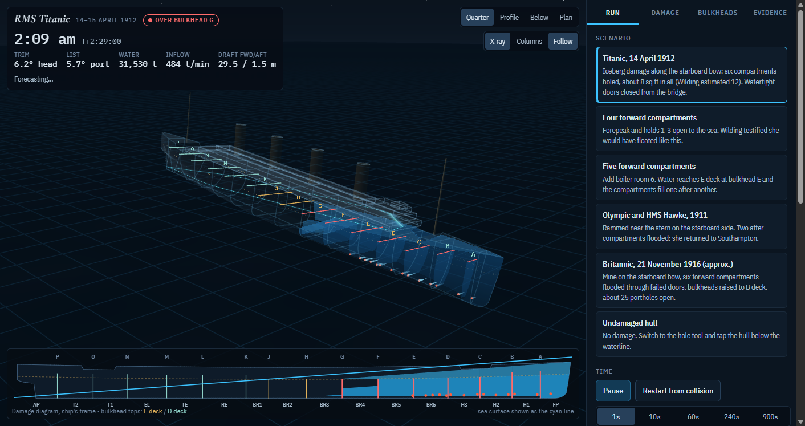

*2:09 am, 149 minutes after the collision (from an earlier version of the model): 6.2° down by the head, 5.7° list to
port, 31,500 t of water aboard, water flowing over bulkhead G. Quarter view with the X-ray hull; the damage diagram
below shows the sea surface against the bulkhead tops.*

### Run it

- **Viewer.** Open [`out/titanic.html`](../../out/titanic.html) in a browser. No install and no server: three.js and the
  fonts load from CDNs. Pick a scenario card, press play, choose a speed (1× to 900×; 60× plays the two hours and
  forty minutes in under three minutes). Quarter, profile, below and plan cameras; X-ray hull, column proxies and a
  follow camera. The Damage and Bulkheads tabs edit the scenario, the hole tool adds openings where you tap the hull,
  and the Evidence tab plots the run against the eyewitness reconstruction. Rebuild the page with `node tools/build.js`.
  That file is viewer version 1; the website build below is version 2, with a phone layout and no third-party
  requests, and it is the one to host. Version 1 is superseded: its page was last built on 8 October 2026, with the
  model and the calibration of then, before the history match (`tools/history_match.js`; CLAUDE.md says how).
- **Headless.** Node 18 or later, nothing to install:

| command | what it does |
|---|---|
| `node tools/titanic.js` | the calibrated 1912 run as a table, against the eyewitness trim and list |
| `node tools/validate.js` | the validation cases, written to `out/validation.json` (about a minute) |
| `node tools/cases.js` | the classic one- to six-compartment damage cases |
| `node tools/golden.js` | the golden trace of the 1912 run, sampled every 60 s, to `out/golden_titanic.json` |
| `node tools/calibrate.js 45` | refit the four flow parameters (about four minutes); superseded by the history match, `tools/history_match.js` (CLAUDE.md) |
| `node tools/fit_hull.js` | refit the hull form to the Harland & Wolff hydrostatics (about two minutes) |
| `node tools/shot.js 1400 860 4000 shot.png` | screenshot and drive the viewer with Playwright |

The same commands exist as npm scripts (`npm run titanic`, `npm run validate`, ...).

### The website build

`dist/` is a static site ready for Cloudflare Pages or any static host: the same model and viewer, packaged as
version 2 with a proper document, a phone layout, vendored three.js and fonts, strict headers and an installable
manifest. `CHANGELOG.md` lists what the review of version 1 found and what changed.

```bash
npm ci                   # Playwright, wrangler, three.js r128 and the fonts are dev dependencies
npm run build:site       # assembles dist/ (content-hashed assets, version.json)
npm run serve            # http://127.0.0.1:8080/ for a local look
npm run test:site        # desktop, iPhone, Pixel and iPad through Playwright; screenshots in docs/site/
npm run pages:dev        # the build under Cloudflare's local Pages runtime
```

**Live:** https://bochen.xyz/titanic/ (also https://titanic-sinking-simulator.bochen2029.workers.dev)

Deploying on Cloudflare: `npm run deploy` publishes `dist/` as a static-assets Worker (`wrangler.toml`; this is
what Cloudflare Pages has become), after `npx wrangler login` once. No domain is needed to start; the site answers
on the account's `workers.dev` subdomain, and a custom domain attaches later with a `routes` block in
`wrangler.toml`. `dist/_headers` and `dist/404.html` apply as they would on Pages. Set
`SITE_ORIGIN=https://your.domain/` at build time so the social preview image has an absolute URL.

<table>
<tr>
<td width="34%">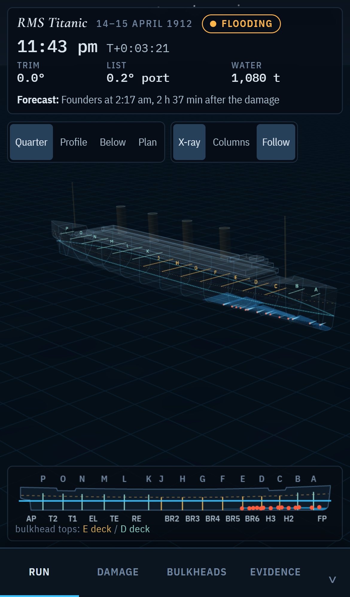</td>
<td width="34%">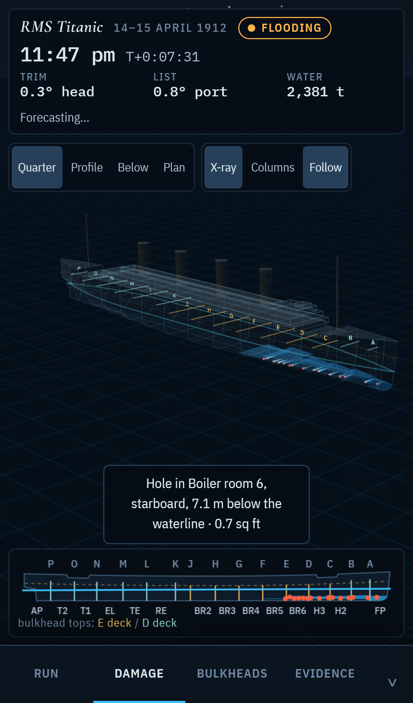</td>
<td width="32%">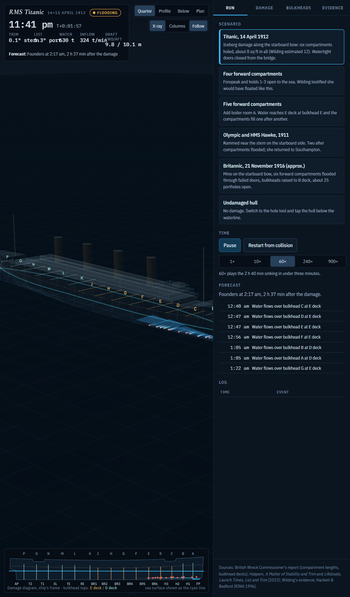</td>
</tr>
<tr>
<td><em>Version 2 on an iPhone: the panel is a bottom sheet.</em></td>
<td><em>A tap on the starboard shell adds a hole; the forecast recomputes.</em></td>
<td><em>Version 1 on the same phone, for comparison.</em></td>
</tr>
</table>

### The user guide

`docs/guide/USER_GUIDE_v1_6_2026-11-21.pdf` is built from the Markdown chapters in `docs/guide/src/`:
`node tools/build_guide.js` (about 10 s) writes the HTML and prints the PDF with headless Edge or Chrome; its tables of
results, the readers' accounts of the 1912 night and its pictures come from the repository and the built site.
`node tools/guide_shots.js` retakes the pictures from `dist/` (about a minute), and `node tools/guide_check.js` fails
when the guide and the simulator have drifted apart. `docs/guide/README.md` says how to edit it.

### Take the bridge

The website build can also be sailed. *The watch, 14 April 1912* puts you on the bridge at 11.39 pm, 22½ knots on
course 266°; *Another night* draws a berg from a seed. Nothing is in sight until the lookout rings three bells. From
then on the wheel and the engine-order telegraph are yours, and the damage is whatever the ice makes of your orders:
clear it and she is intact, touch and the plating dents, grind along it and the seams open where the ice went, run
her stem in and the bow crushes. No hole is painted. The flooding core then does what it always did.

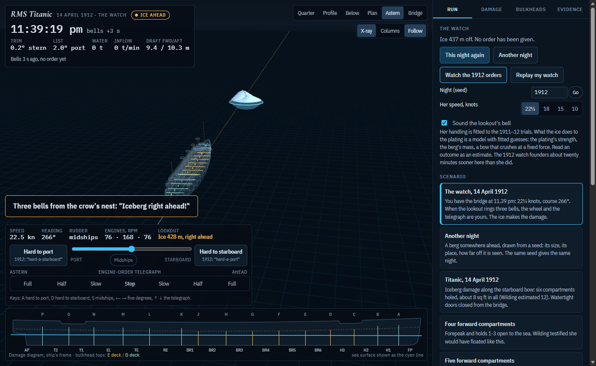

| Piece | File | Checked by |
|---|---|---|
| The ship under way: surge, sway and yaw, three shafts, one rudder, fitted to the 1911-12 trials | `core/motion.js` | `node tools/trials.js` |
| The berg, the contact, dents and opened seams, the crushed bow | `core/encounter.js` | `node tools/encounter_tests.js` |
| The seeded night, the lookout, the bridge's orders and their log | `core/night.js` | `node tools/night_tests.js` |
| The watch in a real browser, through the buttons | `site/app.js` | `node tools/night_site_test.js` |
| The screws, rudder, wake and lights as numbers; then in a browser | `site/visuals.js` | `node tools/visuals_tests.js`; `node tools/visuals_site_test.js` |
| The ship's systems and what each needs: coal, fires, steam, engines, turbine, steering, dynamos, pumps | `core/systems.js` | `node tools/systems_tests.js`; `node tools/systems_site_test.js` |
| The end of a watch in plain words, and a link that replays it | `site/parts/40_night_end.js` | `node tools/night_end_site_test.js` |
| The Night look, the crow's nest, a boat lying off her beam | `site/parts/20_night_scene.js` | `node tools/night_scene_site_test.js` |
| A director: the camera chooses the view at each moment of the night | `site/parts/80_director.js` | `node tools/director_site_test.js` |
| Her sounds: wind, sea, engines, ice, water, her structure, her bell, each level following a number in the model | `site/parts/30_sound.js` | `node tools/sound_site_test.js` |
| The hull girder's gauge: her weight along her length, the bending moment of her hull against the studies' range | `core/readers/girder.js`, `site/parts/55_girder.js` | `node tools/girder_tests.js`; `node tools/girder_site_test.js` |
| The boats: twenty of them, fitted to the recorded launch sequence; orders to uncover, fill and lower | `core/readers/people.js`, `site/parts/50_boats.js` | `node tools/people_tests.js`; `node tools/boats_site_test.js` |
| Reports to the bridge: what was seen, sounded and reported, late and partial; the bridge's view | `core/readers/reports.js`, `site/parts/60_reports.js` | `node tools/reports_tests.js`; `node tools/reports_site_test.js` |
| Help: the wireless, the rockets, Carpathia and the other ships | `core/readers/world.js`, `site/parts/70_help.js` | `node tools/world_tests.js`; `node tools/help_site_test.js` |
| The first search for the Carpathia question: orders after the ice, minutes afloat, the best nights on forty models | `tools/carpathia.js` | `node tools/carpathia_tests.js` |
| Her strength along her length (Smith's method) and the onset of the break as a mark, "she would break here, now" | `core/readers/section.js`, `core/readers/onset.js`, `site/parts/55_girder.js` | `node tools/strength_tests.js`; `node tools/girder_site_test.js` |
| Her fall to the bed: two rigid bodies from the founder flag, 3,790 m down on physics | `core/readers/fall.js` | `node tools/fall_trials.js` |
| The deep: the page follows her pieces down, with four views, a strip of the sea to scale and the survey's outlines at rest | `site/parts/75_deep.js`, `site/app.js` ("the fall") | `node tools/deep_site_test.js` |
| A walk inside her on the core's own water (W0) | `site/parts/76_walk.js` | `node tools/walk_site_test.js` |
| Her rooms at level 0: the core's spaces cut at her decks, the water shared out from the core's own (R1) | `core/readers/rooms.js` | `node tools/rooms_tests.js` |
| Her rooms from the deck plans, as sourced tables: nine decks, the orlop to the Boat deck (R3) | `data/rooms/`, `tools/rooms_table.js` | `node tools/rooms_table_tests.js` |
| The ship as numbers and a recorded night, for Blender and Unreal (U0) | `tools/export_ship.js`, `tools/record_night.js`, `tools/export_json.js` | `node tools/export_tests.js` |
| Her wake computed: a wave field from her own hull, and the white water it makes; her waterline and the night's sea and reflections follow it (K4) | `site/parts/24_wake_field.js`, `site/parts/25_wake.js`, `site/parts/26_wake_seams.js` | `node tools/wake_tests.js`; `node tools/wake_site_test.js` |
| The tiers above B deck, their windows, and the two grand staircases with their domes: what keeps the sea out of her upper works, and when each gives way | `core/core.js` (`TIER`, `STAIRS`, `WINDOWS`) | `node tools/stairs_tests.js` |

`node tools/gate.js` runs every suite and gives each one line (about ten minutes; `--quick` for the fast ones).

- **What she shows of it.** Her three screws turn with the model's shafts: the wing screws outward, running down, stopping and
  going astern with the engines; the centre screw only when the turbine is in. The rudder lags the wheel at its 4
  degrees a second, and the Bridge has an indicator with both needles. Her wake is laid on the sea where she was: a
  white ribbon from her stern, and Kelvin's arms and crests constructed from her own path (19.47 degrees, crests 57 m
  apart along the arms at 22.5 knots, 11 m at 10). Her navigation lights follow the 1910 rules: green, red and the
  masthead light each show only inside their arcs, so from her bridge you see none of them. The Screws view looks at
  the stern gear under water. Going astern, the wing screws' wash creeps forward along her sides and reaches amidships
  as she loses her way; with sternway the stern follows the rudder. In the X-ray hull both engines work at their shafts'
  angles and the turbine turns only when it is in. Her ports are lit until the dynamos stop: water reaches them, or the
  steam to drive them fails (in the 1912 run her boilers and mains give way as she rises past 20 degrees: 2:16 am). The telegraph's gong answers every engine
  order, the engines beat once a revolution, and her smoke trails her track. The shapes and their sources are in `site/visuals.js`; the stern's places were measured
  from The Shipbuilder's 1911 figures (`docs/research/RESEARCH_stern_gear_wake_lights_v1_1_2026-11-16.md`).
- **The night, and the eyes of people who were there.** The Night button draws what a person would have seen: a
  moonless, clear, flat-calm night, stars to the horizon and in the glassy sea, a black sea, a lit ship, and a berg
  that is a dark shape with no white water at its foot, which is why it was seen so late. Crow's nest is the
  lookouts' eye on the foremast; Boat is the eye of someone in a lifeboat lying 300 m off her beam, fixed where it is
  while she moves on or goes down: the view of the sinking that survivors described. X-ray is still how the physics
  is read. All of it is appearance (`site/parts/20_night_scene.js`).
- **A director.** The Director switch hands the camera to the night: the bells from the crow's nest, the touch from
  her bow, the boats and her last minutes from a boat off her beam, a rocket from above, each with a small caption of
  the ship's time, and her last minutes held at her own pace whatever pace was chosen. Any view button takes the
  camera back (`site/parts/80_director.js`).
- **The ship heard.** Her own wind and the sea along her side grow as the square of her speed: on a flat calm the
  only wind on her is her own, so when the engines stop the night goes quiet. The engines rumble with the shafts'
  revolutions, the ice grinds with the force of each step of the contact, the water rushes in with the inflow, her
  structure creaks as her trim moves, and her bell strikes the half hours. Each view hears its own mix; the volume
  sits beside the sound switch; the levels are guesses until someone has listened (`site/parts/30_sound.js`).
- **After the ice: the hours that were only watched.** Four readers of the watch, none of which changes a bit of
  the night. Reports reach the bridge as they did, late and in words (a man sent to look, the carpenter, the mail
  clerk, the builder's man with his hour and a half), and the view "As the bridge knew it" hides every number nobody
  has reported. The boats can be uncovered, filled and lowered, twenty of them, fitted to the recorded launch
  sequence (14 of 18 within ten minutes; 661 in the boats against the record's 671). The wireless calls, the
  rockets go up, and Carpathia comes: alongside 265 minutes after the collision on the 1912 orders, sooner if the
  call is made sooner. And a gauge shows the bending of her hull against what the studies say it could bear: on
  the 1912 damage it enters that range at 2:10 am and passes its top at 2:16. Nothing breaks yet.
- **The Carpathia question, searched.** A program tries the orders the model has after the ice, the way a player gives
  them, and reruns the best nights on forty models with the guesses moved (`tools/carpathia.js`). On this model the best
  it found keeps her afloat 14 minutes longer, pumps and one door raised so that its float lets water through to them,
  where Carpathia needed her afloat 36 to 107 minutes longer: no orders the model has come near. The one large lever it
  has is holding every watertight door open against its float, which no order can do and which leaves her listing over
  20 degrees and dark for an hour (`docs/research/RESULT_carpathia_search_v2_2026-11-20.md`, the rerun on the model with
  the tiers and the staircases; v1 of 2026-11-18 had 12 minutes).

<table>
<tr>
<td width="34%">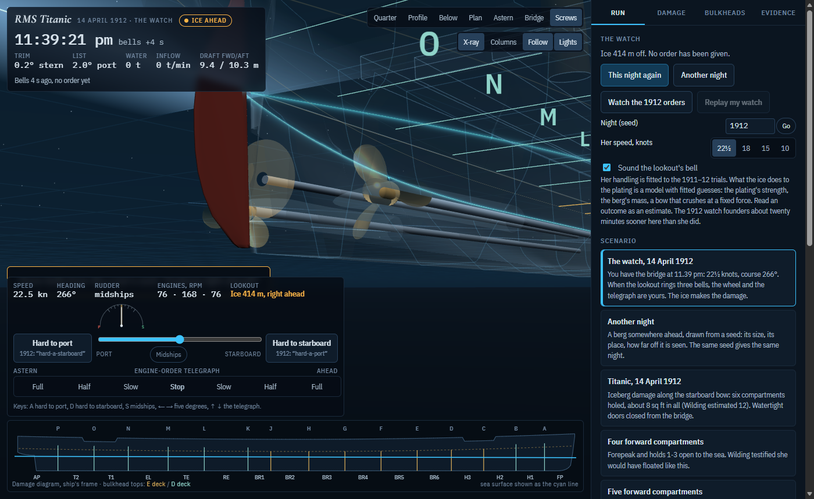</td>
<td width="33%">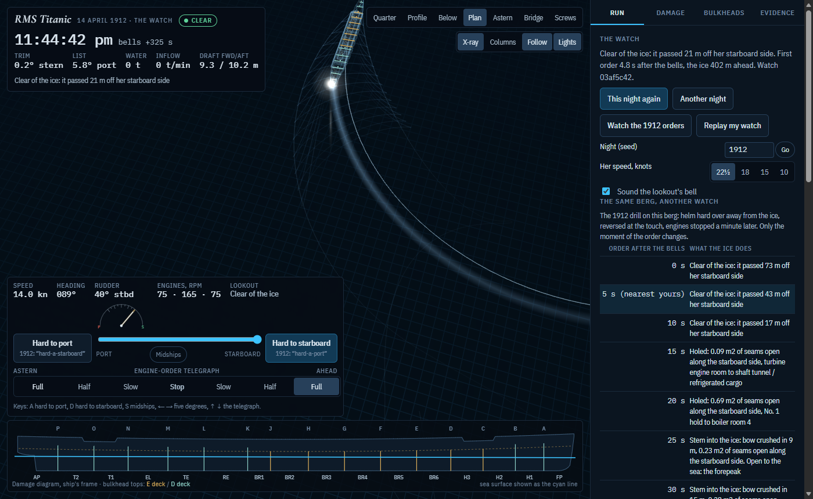</td>
<td width="33%">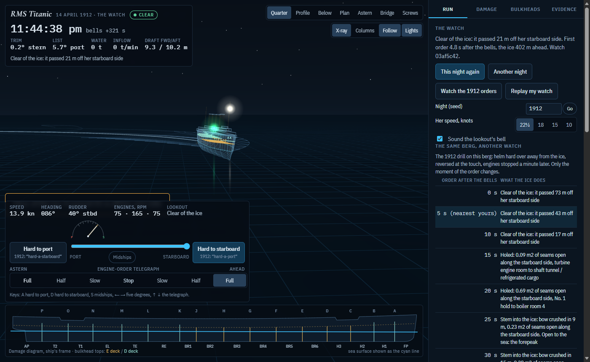</td>
</tr>
<tr>
<td><em>The Screws view: rudder, starboard and centre screws, shafts.</em></td>
<td><em>Hard over: the wake laid where her stern went.</em></td>
<td><em>Off her starboard bow: green and the masthead light.</em></td>
</tr>
</table>

- **Her systems need each other.** The rudder works only on water moving past it, so she cannot turn without way on
  her, and the faster she goes the faster she turns. Her way comes from the screws; the screws from the engines and the
  turbine on their exhaust; the engines from the steam; the steam from the fires in six boiler rooms; the fires from
  coal. The same steam moves the rudder (steam steering engines, worked from the wheel by a hydraulic telemotor) and
  turns the dynamos that light her. Flooding breaks the chain where the water is: a boiler room's fires go out, an engine
  room stops both engines, the dynamo flat puts her in the dark. As her stern rises the screws and the rudder leave the
  water, and Full ahead then pushes nothing. The watertight doors at the tank top drop from the bridge by electromagnets,
  so in the dark the bridge's switch does nothing; a float under each room's floor still drops the doors into it when
  water comes in, and a lever at each door works by hand. Her steam bilge pumps, 1,700 tons an hour in all, work
  against the water while there is steam: the engineers put a room's own pumps on it when water comes in and lead more
  to it through the bilge main later, and a pump stops when its own room floods. Against the 1912 damage they buy
  two and a half minutes. The Systems tab shows each link and its state, and gives two kinds of order. To the
  stokehold: draw the fires. To the pumps: a room's own pumps, every pump that can reach it, or one pump put on it (on a room that is making water, or on one still dry before the
  water reaches it), a pump taken off, or the pumps handed back to the engineers. A pump on its own room works five minutes after the
  order, one led through the main half an hour after it; the holds can be pumped only until the firemen's passage
  floods, about five minutes after the collision in 1912. The orders go in the watch's log, and the forecast after
  the ice runs the watch on with them. With nothing failed the plant changes nothing, to the bit.
- **A night is its seed and its orders.** Every order is logged with the step it was given at, so a watch replays
  bit for bit on the same JavaScript engine. Two engines agree to nine digits and part in the last bit of some library
  functions. The model now computes the sine and cosine itself (E1), and since join 8 ten more (E2a: exp, log, log10,
  tan, atan2, hypot, tanh, asin, acos, cbrt), each equal to Node's on every input tried; only `pow` in the step is
  still the engine's (the calibration epoch's stage B; see the caveat below).
  Seed 1912 is the reconstructed night. `#night=1912` in the address opens it; `Replay my watch` plays yours back. Any order given after the ice makes the watch yours, so a watch begun on the 1912 orders can be replayed with what you did.
  When a watch ends (she founders, lies steady, or has cleared the ice) a card says what happened, and
  `Copy a link to this watch` puts the seed and the orders in the address, so that anyone who opens it sees the same
  watch. Orders that arrive in an address are checked before they reach the model.
- **Headless:** `node tools/night_run.js 1912 auto sink` runs the 1912 orders and the sinking; replace `auto` with a
  number of seconds for the same drill with the helm order that long after the bells, or with `none`.
- **What is fitted, and what is a guess.** Her handling is fitted with four numbers to a consensus of the three
  sisters' trial record (`docs/research/RESEARCH_handling_consensus_v1_2026-11-16.md`): Olympic's two points in 37 s
  with her engines reversed, Titanic's 3,850 ft circle, circles that barely change with speed, and the 3,000 ft crash
  stop, run as the trial was, its engines "reversed more slowly than usual". Her resistance has the speed shape of
  Holtrop's method and her screws turning astern the shape of the B-series' four-quadrant data
  (`docs/research/RESEARCH_propeller_four_quadrant_v1_2026-11-17.md`). Eighteen of the record's twenty-one other
  figures fall inside the consensus's bands (`node tools/trials.js`); the three outside are her speed at 60 rpm (0.18 knots
  over), the distance run in the 37 s (3 m short) and her stop from half speed (another ship's figure, which no screw
  law reaches). The ice is not measured: the plating's
  resistance, the berg's mass, the seam gap per metre of dent and the force at which a bow crushes (rising with the
  depth crushed, from section-based crushing laws; Wilding's 80 to 100 feet at full speed) are bets with a physical
  meaning, named in `core/encounter.js`. The contact law converges as it is
  refined (P3c), so a course a fraction of a degree off no longer changes the damage. The 1912 watch's damage runs
  from near the stem into boiler room 5 and sinks her 158 minutes after the touch, against 157 to 160 on the night;
  the ice's place that gives it was fitted, and she grazes the edge of a stem strike there, so read other outcomes
  near it with care.

### What the model does

| Piece | How |
|---|---|
| Hull | Parametric form: parallel midbody, waterline exponents by height, bilge radius, raked stem, elliptical counter, sheer, tumblehome. Fitted to the Harland & Wolff hydrostatics at 32'3" and 34'7", within about 1 % on displacement, waterplane area, KB, BM, LCB and midship coefficient. |
| Proxies | 4,408 vertical columns (3 m × 0.5 m) in the ship frame. Buoyancy and flood water are both integrated over the same columns at the actual pose, so there are no lookup tables. |
| Subdivision | 15 bulkheads at the British Inquiry positions, with tops at C, D or E deck as built, giving 16 compartments. Each compartment has 4 spaces, port and starboard times below and above E deck, 64 in all. Permeability is set per compartment. |
| Superstructure | The hull's own top is B deck. Where the three tiers above it stand (B to A deck, A deck to the Boat deck, the houses on the Boat deck), each compartment's space above E deck goes up through them, so they are buoyant while they are dry and hold water afterwards (S1, 19 November; about 25,500 m³). Their sides are whole until a window breaks. |
| Water paths | 392 connections on the 1912 damage. Hull openings, doors and deck openings use an orifice law; flow over bulkhead tops and the open deck uses a weir law, Villemonte's factor when submerged. Port and starboard halves of an open space share one free surface. A full space is pressed up by the head above it. |
| Openings above B deck | The tiers' windows, and the two grand staircases' entrance doors and domes (S1). Each holds until the head of sea on it reaches its strength (a wooden door 1.0 m at its sill, a window 1.5 m, a dome's weather cover 0.5 m, or the air shut in under it once the hall's doors are drowned), then is open for good. A door or a window runs by the pressure summed over its height; a dome's well by the smaller of a weir round its rim and an orifice through it. The strengths and the laws are from the literature, with their ranges, in `docs/DESIGN_grand_staircases_dome_flooding_v1_2026-11-19.md`. |
| Ship | Damped rigid body in heave, pitch and roll. Mass properties from the drafts of 14 April (30'9" forward, 33'9" aft) with GM 2 ft 7.5 in (Hackett & Bedford). |
| Step | 0.25 s. About 11,000 steps per second single-threaded, so a full sinking takes about three seconds headless. |

The core is deterministic, uses flat typed arrays and a fixed step, and has no DOM, so it ports line for line to
C++ and CUDA. `core/core.js` is the whole physics; `core/scenarios.js` holds the damage presets and the eyewitness data.

### Calibration

Superseded since stage D's landing by the history match (`tools/history_match.js`; CLAUDE.md says how). What follows
is the fit as it stood before it.

Four parameters, fitted by Nelder-Mead in `tools/calibrate.js` to Halpern's eyewitness-derived trim curve (2023),
the foundering time, and three timeline events. The 1912 run has its pumps as they were worked on the night (boiler
rooms 5 and 4; Y3, `docs/research/RESEARCH_pumps_bilge_ballast_v1_2026-11-17.md`), and the three flow parameters were
refitted with them, the opening held; and again on 19 November with the tiers above B deck, their windows and the
grand staircases (S1), the opening still held. On 20 November (join 6) boiler room 5 took the record's damage (G6, W6)
and the preset and the watch one damage split, Hackett and Bedford's opening areas (G6b). The fit now holds the 1912
watch's own foundering beside the preset's, both within 157 to 160 minutes, inside bounds that keep every validation
verdict (D73: `wMul` at most 1.1, `aDown` at least 0.24); the opening was refitted, +4.6 %. On 21 November (join 7)
the forepeak held its water to the peak tank's watertight top, as the record has it (G7), and the passages along E
deck took the plans' widths (G11). The opening was refitted, +4.4 % again. The 1912 watch is held to the band on both
of its branches: the engineers' one decision to lead pumps to boiler room 4 falls either side of its threshold on a
change in the last bit (BACKLOG G18). So the fit holds her founder on the watch inside the band as it is (159.0
minutes) and with no pumps led through the main at all (157.2 minutes).

| Parameter | Value | Meaning |
|---|---|---|
| Aggregate opening | 0.820 m² (8.82 sq ft) | Iceberg damage, shared over six compartments by Hackett & Bedford's opening areas (JOM 1998, Table I); 0.785 m² before join 7 |
| `wMul` | 1.1 | A factor on the widths of the paths over the bulkheads along E deck: the plans' at bulkheads D to J since join 7 (Scotland Road 2.24 m, the starboard alleyway 1.49 and 1.40 m; G11), 3.0 and 2.0 m elsewhere; weakly held by the record, on its bound since join 6 (1.04 before, 2.74 before S1, 1.18 before the pumps) |
| `aDown` | 0.28 m² | Openings down through E deck, per side per compartment (0.26 before join 7, 0.28 before join 6) |
| `fOpen` | 0.021 | Share of the top deck open once submerged (0.022 before join 7, 0.021 before join 6, 0.014 before S1) |

| Check | Witnessed | Model |
|---|---|---|
| Trim at 12:10 / 12:55 / 1:20 / 2:15 | 1.8° / 3.2° / 4.0° / 10° | 1.67° / 3.32° / 4.02° / 8.12° |
| Water over bulkhead F (Wheat) | 12:55 | 12:57 |
| Bridge under | 2:15 | 2:16 |
| The forward dome gives way | no witness; in the minute of the break by the record's trim (2:16 to 2:18) | 2:17 |
| Foundered | 2:20 (broke at 2:17) | 2:18 |
| 16,000 tons aboard | 12:20 (Wilding's assumption) | 12:55 |

The eyewitness timeline fits about 8.8 sq ft of opening. Wilding's 12 sq ft rested on 16,000 tons arriving in 40
minutes; the model takes 75 minutes to reach that much.

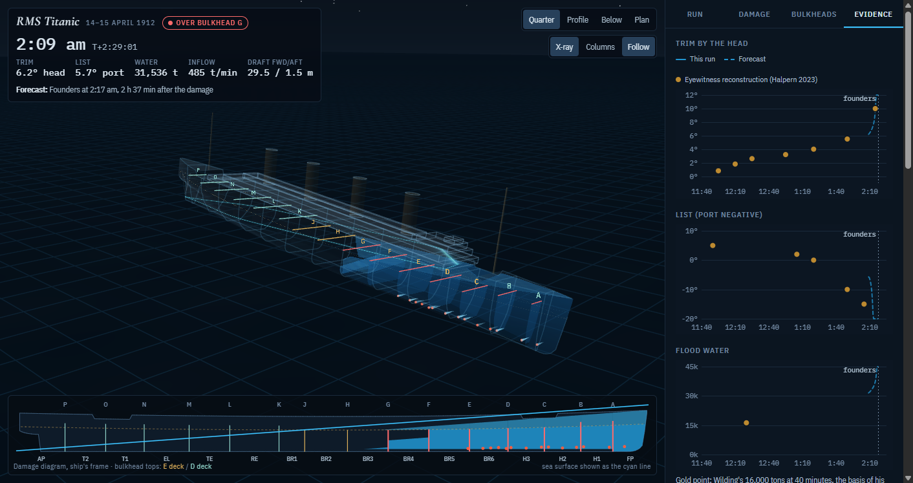

*The Evidence tab at 2:09 am: trim, list and flood water of the run (blue) against Halpern's eyewitness
reconstruction (gold), with the forecast to foundering dashed.*

### Validation: the cases that bound the fit

Since join 6 (D69 and D75, the coordinator's ledger) the calibration keeps every verdict here whose source is clear.
Two are reported each time and do not bind it: the bulkheads to B deck, where the sources disagree (Wilding against
the later Britannic design claim), and the doors left open, which are debated.

| Case | Record | Model |
|---|---|---|
| Forepeak + holds 1–3 open | Wilding: floats | Floats, 2.1° by the head, 0.94 m below bulkhead D's top |
| Add boiler room 6 | Wilding: sinks | Founders |
| Olympic and HMS Hawke, 1911, two after compartments | Reached port | Floats, 0.7° by the stern |
| Britannic 1916 (approx.: B-deck bulkheads, failed doors, 25 open ports) | About 55 min | 49 min |
| Britannic, ports shut | Designed to float with 6 flooded | Floats, 8.0° |
| Titanic damage minus the BR5 seam | Wilding: still sinks, slower | 3 h 11 min |
| Titanic, bulkheads to D deck | Wilding: no help | 2 h 46 min |
| Titanic, bulkheads to B deck | Wilding: still sinks | Founders after 5 h 20 min, about an hour after Carpathia's arrival: this agrees with Wilding. Before join 7 she floated at 8.5°, as the later Britannic design claim has it; the peak tank holding the forepeak's water to its top (G7) tips the case, which was a knife edge before (e90). Reported, not binding: its sources disagree |
| Titanic, doors left open | Debated | 2 h 50 min, longer: water spreads aft low instead of tipping the bow |
| Titanic, pumps as worked against none | The Court: they could not have prolonged her life appreciably | 3.7 min longer (479 t pumped); every pump on every suction, never abandoned, 19 min |

The full table with event times is in [`out/validate.txt`](../../out/validate.txt).

### Known gaps

- **List.** The model gets a 3° to 8° port list, the pre-collision coal list amplified by free surfaces, but not the
  5° starboard list at 11:50 or the 10° to 15° port list at 1:50 to 2:05. Candidates are asymmetric flooding of the
  boiler-room coal bunkers, water running aft along Scotland Road, and the port gangway door Lightoller ordered
  opened. `HANDOFF.md` works each of them out.
- **Structure.** No hull girder failure. Intact, the model's last minute is a rolling plunge rather than the break-up
  at about 2:17. Since S1 she is nearly upright as the sea reaches the bridge (2° to port, where she rolled 29° before
  and the record has about 10°), and rolls over only once the tiers' windows have gone: above E deck each space is
  open from side to side, without the cabins' fore-and-aft walls.
- **The fall.** She goes to the bed in two pieces cut at the girder's station at the founder flag: an interim rule (H1),
  where the break by her own loads waits for the hinge and the air space by space (backlog 2f, Z6 and B4). Handed over
  at the flag on the core's 80 degrees of list, both pieces now land upright, as the wreck's do (G12, join 7: each
  piece's lumped air lifts through its slices' floodable centres, where before it stayed frozen where the air lay at the
  flag and turned them over). The margin is 2.6 degrees of list before the bow turns over; mending the core's
  last-minute roll (Z9, BACKLOG G17) would widen it. Her air is one lumped pocket a
  piece, so a bow let go at the surface stands on its nose and lands about 1.4 km off where the wreck's bow lies 772 m
  from the boiler field (with its air let out it lands 724 to 808 m off: experiments e63, e64). On a watch
  the night's clock, the boats and the wireless stop at the flag while the pieces fall, until Z3. Every preset that
  founders falls to the 1912 sea's 3,790 m, the Britannic's included, which lies in 119 m (Z3, Z8).
- **The onset's place.** Her own loads reach her computed strength at x -10.93 (boiler room 2), 5 m forward of the
  record's band (-16 to -27), at T 155.0, two minutes early: the demand peaks amidships and the strength does not fall
  off aft enough. A finding, reported, not tuned.
- **The decks above E deck are one space** in each compartment, from E deck to the top of what is shut in over it.
  Where a grand staircase stands, its well makes that fair; elsewhere water that comes in at a B-deck window reaches
  the decks below sooner than it would (backlog S1c). No witness saw a dome give way: its going is a reconstruction,
  and in the model it is the air shut in under it that opens it, seconds after the hall's doors.
- **Her way after the ice.** Since M7 a stopped screw drags and she loses her way about twice as fast as before, but
  on the 1912 orders she still makes 3.5 knots at T+15 and 1 knot at an hour, where the record has her nearly
  stopped by T 15 to 20. No witness's engine movements close the gap on the model
  (`docs/research/RESEARCH_way_after_stop_v1_2026-11-18.md`, section 9); what is left may be her resistance at low
  speed when flooded (the hydrodynamics stay at the intact draft) and the rest of M5.
- **Omissions.** No trapped air (but for the rule that opens a dome's cover). Forward speed reaches the openings
  only roughly (P5, Tier 0: the stagnation of the plating's angle to the flow and a bow wave, no pressure table for this
  hull), and the presets lie stopped, which matters for Britannic. The pumps are in (Y3), but only the 1912 run and a
  watch work them: the other presets lie unpumped.
- **Britannic.** Her hull is treated as Titanic's with a slightly narrower beam. Which six bulkheads went to B deck,
  and where the open ports were, are assumptions.

<table>
<tr>
<td width="50%">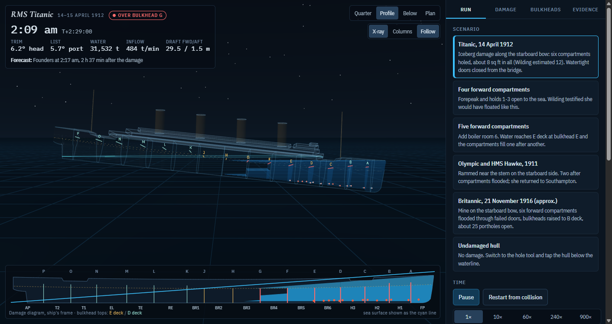</td>
<td width="50%">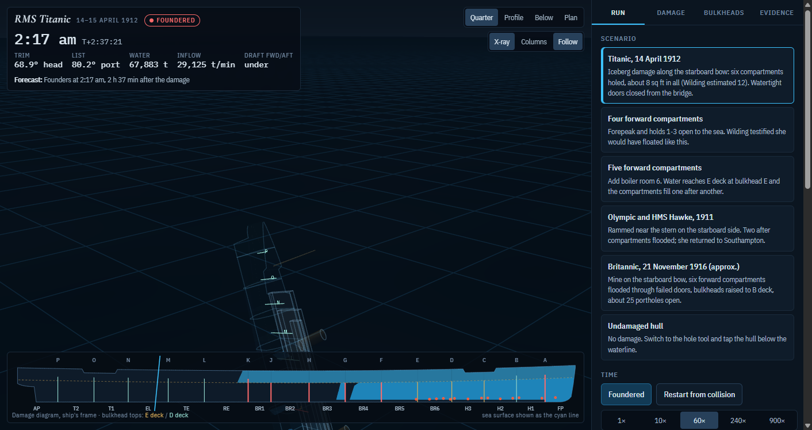</td>
</tr>
<tr>
<td><em>Profile view at 2:09 am.</em></td>
<td><em>2:17 am. The intact model ends in a plunge; the break-up is on the list.</em></td>
</tr>
</table>

### The port, and the oracle

The C++/CUDA port, [sinksim](https://github.com/bochen2029-pixel/sinksim), reproduced this model as it stood in
October bit for bit at every step of the 1912 run. It has not followed the core since: it is about seven features
behind, and `PORTING.md` and `HANDOFF.md` describe the October core. It runs batches of sinkings on the GPU, one CUDA block per simulation, for calibration
sweeps and a tree search over the watertight doors, the pumps and counter-flooding. The question it is built to
answer is whether any policy could have kept her afloat until Carpathia arrived, about 4 h 20 min after the impact,
against the 2 h 37 min of the baseline. [`PORTING.md`](../../PORTING.md) is the kernel plan; [`HANDOFF.md`](../../HANDOFF.md)
is the order of work, the invariants that are easy to lose in a port, the physics still missing, and the parameters
the author is least sure of. [`CLAUDE.md`](../../CLAUDE.md) holds the frames and rules a working session starts from.

Until the port matches it, **the JavaScript core is the oracle** and [`out/golden_titanic.json`](../../out/golden_titanic.json)
is its frozen trace: the 1912 run sampled every 60 s with pose, rates and all 64 volumes. One caveat was measured
while preparing the port: `Math.pow` in V8 calls the C runtime Node was built against, so a golden trace made on
another machine can differ in the last bit, and this model, like any flooding model with threshold events, turns one
ulp into event times that differ by up to 24 s after about an hour of simulated time. The measurement, and a header
that reproduces Node's `Math.*` bit for bit in C++, are in the companion repository
[v8math](https://github.com/bochen2029-pixel/v8math). Regenerate the oracle on the machine that will consume it.
A second measurement, on 20 November 2026 (`docs/research/experiments/e70_engine_math_probe.js`): between Node and
Electron's V8 on one laptop, `Math.pow` agreed on 800,000 inputs, while `Math.sin` and `Math.cos` differed by one ulp
on about 3.5 % of angles. The model's sine and cosine are now its own (E1: `C.sin`, `C.cos`, fdlibm's in plain
arithmetic, equal to Node's own on every angle tried), so a watch no longer leans on an engine's for them; its other
transcendental functions are next (backlog X1).

### Layout

```
core/core.js        the flooding core: hull, columns, nodes, connections, step, rigid body, events, snapshots
core/scenarios.js   damage presets (1912, four and five compartments, Olympic-Hawke, Britannic) and the eyewitness data
core/motion.js      the ship under way: surge, sway, yaw, engines, telegraph, rudder (joined to the core by its seams)
core/encounter.js   the berg and the contact: dents, opened seams, the crushed bow, handed to the core as openings
core/night.js       the seeded night and the watch: lookout, orders, the log that replays a night
core/systems.js     the ship's plant: coal, fires, steam, engines, turbine, steering gear, dynamos, pumps, and what flooding does to them
web/                viewer version 1 (app.js) and its page template, built into out/titanic.html
site/               viewer version 2: page template, stylesheet, app, worker glue, icons, Cloudflare headers;
                    visuals.js holds the shapes of the screws, rudder, wake and lights as plain numbers
dist/               the built website (npm run build:site)
tools/              headless runs, validation, cases, calibration, hull fit, golden trace, builds, site tests, screenshots
out/                the version 1 page, the golden trace, validation results, calibration log
docs/               screenshots; docs/site/ holds the device-test captures
PORTING.md          how the core maps onto C++/CUDA, and the golden tests a port must pass
HANDOFF.md          order of work, invariants, physics gaps, uncertain parameters, the Carpathia question
BACKLOG.md          what is wanted and not built, each item with its test
CLAUDE.md           conventions and rules for working sessions
```

### Sources

The full list of the model's sources is in [`SOURCES.md`](../../SOURCES.md). The first ones were:

- British Wreck Commissioner's report: compartment lengths and bulkhead decks.
- Halpern, *A Matter of Stability and Trim*: displacement, KB, BM, GM, LCF, drafts.
- Halpern, *Lifeboats, Launch Times, List and Trim*, Part II (2023): trim and list against time.
- Wilding's evidence at the British Inquiry: 12 sq ft, 16,000 tons, a head of about 25 ft.
- Hackett & Bedford, *The Sinking of S.S. Titanic, Investigated by Modern Techniques*, RINA Transactions 1996.
- Chirnside on Britannic's open ports and the Olympic-class subdivision.

### License

MIT. The viewer loads [three.js](https://threejs.org/) (MIT) from a CDN at runtime.
